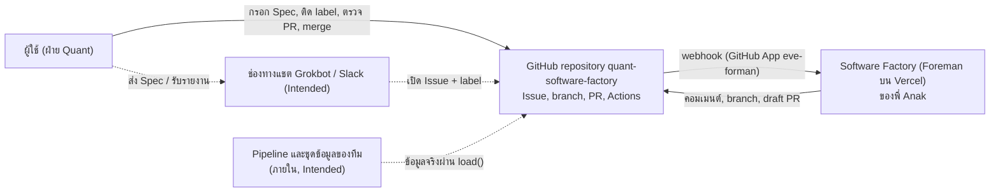
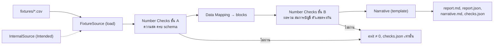
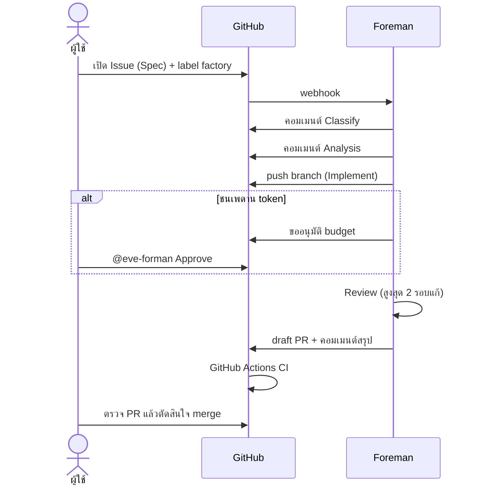

# Reporting Spec Structure for Software Factory: Software Design

- โครงการ: Reusable Report Spec Structure สำหรับ Software Factory ของฝ่าย Quant
- ผู้จัดทำ: Inthanon Ratnavardhana
- มาตรฐานอ้างอิง: ISO/IEC/IEEE 42010:2022 (กรอบอธิบายแบบย่อ ไม่ใช่การรับรองความสอดคล้อง)

| Document Version | Last Updated | Status |
|---|---|---|
| v1.0 | 19 พ.ย. 2569 | Current |

Change Log (ประวัติทุก version ดูได้จาก history ของไฟล์นี้ใน git)

| Version | วันที่ | สิ่งที่เปลี่ยน |
|---|---|---|
| v1.0 | 19 พ.ย. 2569 | เปลี่ยนชื่อจาก Design Prototype และย้ายเข้า `docs/` ใน repo จากฉบับที่ส่งเมื่อ 13 พ.ย. 2569 เนื้อหาเดิม เพิ่มหัว version และแก้ลิงก์ |

## สารบัญ

1. Design Overview
2. Spec Structure ในฐานะ I/O contract ของ Factory
3. System Architecture (C4)
4. Agent Workflow และ Sequence
5. Prototype Usage
6. Verification Evidence
7. Traceability
8. Limitations and Future Direction
9. Execution Cost

## 1. Design Overview

เอกสารนี้อธิบายการออกแบบ Report Spec Structure และวิธีที่มันทำงานร่วมกับ Software Factory (Foreman) ของพี่ Anak พร้อมหลักฐานจากต้นแบบ 4 run ใน Iteration 1 ข้อกำหนดอ้างจาก SRS [1]

แนวคิดหลัก: โรงงานรับ input เป็น GitHub Issue อยู่แล้ว สิ่งที่โครงการนี้ออกแบบคือ**รูปแบบของ Issue** ให้งานรายงานส่งเข้าโรงงานได้ซ้ำๆ แล้วได้ผลที่ตรวจได้ โดยไม่ต้องแก้โรงงาน

| มุมมอง | สิ่งที่อธิบาย |
|---|---|
| Spec Structure | หัวข้อของ Spec, block, preset, Data Mapping, Number Checks, Writing Rules |
| Factory | Foreman รับ Issue แล้วสร้าง draft PR (ไม่ได้ออกแบบในโครงการนี้) |
| คุณภาพ | Expected Values, Number Checks ใน `checks.json`, GitHub Actions CI |
| คน | กรอก Spec, ติด label, อนุมัติเมื่อโรงงานขอ, ตรวจ PR และ merge |

## 2. Spec Structure ในฐานะ I/O contract ของ Factory

### 2.1 หัวข้อของ Spec กับสถานีที่ใช้

| หัวข้อใน Spec | Classifier | Analyst | Implementer | Reviewer |
|---|:-:|:-:|:-:|:-:|
| Background, Report Definition | ✓ | ✓ | ✓ | |
| Data Sources (fixture), Data Mapping | | ✓ | ✓ | ✓ |
| Report Blocks, Output Contract | | ✓ | ✓ | ✓ |
| Expected Values | ✓ (ตรวจว่าลงตัว) | | ✓ (เขียน test) | ✓ |
| Number Checks, Writing Rules | | ✓ | ✓ | ✓ |
| Constraints (base branch, dependency) | ✓ | ✓ | ✓ | ✓ |
| Out of Scope, Open Items | ✓ | | | ✓ |
| Acceptance Criteria, Definition of Done | | | | ✓ |

หลักฐาน: ใน Run #1 classifier ตรวจตาราง Expected Values กับ fixture แล้วว่าทุกแถวลงตัว และ reviewer ติ๊ก Acceptance Criteria ครบ 13 ข้อใน PR #5 ใน Run #3 classifier ชี้จุดผิดในนิยามตัวเช็ค (A1 กับ `holdings_daily`) ได้ก่อนเขียนโค้ด

### 2.2 การออกแบบสามรุ่น

| เรื่อง | Template v0.1 (Run #1) | Template v0.2 (Run #2) | เหตุที่เปลี่ยน |
|---|---|---|---|
| ข้อมูลเข้า | ธุรกรรมดิบ ให้โรงงานคำนวณ | ชุดข้อมูลที่คำนวณแล้ว อ้างด้วยชื่อกลาง | ทีมยืนยันว่า pipeline คำนวณตัวเลขไว้แล้ว (specification gap) |
| นิยามตัวเลข | Metric Definitions (สูตร) | Data Mapping (field ต้นทาง) | เหมือนข้างบน |
| การอ่านข้อมูล | อ่าน CSV ตรงๆ | `load(dataset, as_of, accounts)` | ให้เปลี่ยนเป็นข้อมูลจริงได้โดยไม่แก้โค้ดรายงาน |
| ตัวเช็ค | 3 ชั้น (input, บัญชี, เทียบคำตอบ) | ชั้น A ข้อมูล, ชั้น B รายงาน | แยกส่วนที่ pipeline มีอยู่แล้วออกจากส่วนที่โรงงานต้องเขียน |
| Base branch | ไม่ระบุ | ระบุ + `Depends on` | Run #1 แตก branch จาก PR อื่น |
| ข้อมูลหัวรายงาน | ไม่กำหนด (โรงงาน hard-code) | ต้องมาจาก `account_info` | Run #1 |
| ขนาด | ไม่เกิน ~8 block | ไม่เกิน 5–6 block | Run #1 ชนเพดาน token |

Template v0.3 (Run #3 และ #4) ใช้โครงของ v0.2 แต่เปลี่ยน 2 เรื่อง ฉบับรวมที่ใช้งานได้อยู่ใน [`appendix/report-spec-structure.md`](appendix/report-spec-structure.md) และ [`appendix/platform-spec-structure.md`](appendix/platform-spec-structure.md)

| เรื่อง | v0.2 | v0.3 | เหตุที่เปลี่ยน |
|---|---|---|---|
| ชนิดของ Spec | ใบเดียว หรือแตกตามชั้นงาน 3 ใบ | Platform Spec (ทำครั้งเดียว) + Report Spec (1 ใบต่อรายงาน 1 ฉบับ) | Run #2 ชนเพดาน และการแตก 3 ใบทำให้ "กรอก 1 ใบได้รายงาน 1 ฉบับ" ไม่เป็นจริง |
| กติกาตัวเช็ค | A2 บังคับทุกชุดข้อมูล, B8 ขัดกับ Writing Rules | ชุดข้อมูลที่ว่างได้, B8 ตรวจเฉพาะเงินและ % และยอมรับค่าสัมบูรณ์ | spec gap จาก Run #2 |

### 2.3 Block และ preset

Block มาตรฐานได้จากการแตกรายงานตัวอย่างของทีม 3 ฉบับ (รายละเอียดใน Template v0.1 ภาคผนวก A) preset ของรายงานแต่ละประเภทคือการเลือก block ชุดหนึ่ง รายงาน 3 ประเภทจึงใช้ Spec Structure เดียวกัน ต่างกันแค่ preset, Data Sources และ Expected Values

## 3. System Architecture (C4)

### 3.1 System Context

### 3.2 Container

| ส่วน | บทบาท | สิ่งที่สาธิตและจุดตรวจหลักฐาน |
|---|---|---|
| Spec Structure | I/O contract ของงานรายงาน | ฉบับใช้งาน: [`appendix/report-spec-structure.md`](appendix/report-spec-structure.md), [`appendix/platform-spec-structure.md`](appendix/platform-spec-structure.md); ประวัติ: [`appendix/history/report-spec-template.md`](appendix/history/report-spec-template.md), [`appendix/history/report-spec-template-v0.2.md`](appendix/history/report-spec-template-v0.2.md), [`appendix/history/report-spec-template-v0.3.md`](appendix/history/report-spec-template-v0.3.md) |
| GitHub Issue | Spec ที่กรอกแล้ว + trigger | Issue #4, #6, #7, #9 |
| GitHub App `eve-forman` | connector ระหว่าง repository กับโรงงาน | คอมเมนต์ของ `eve-forman[bot]` ใน Issue #4, #6, #7, #9 |
| Foreman บน Vercel | ประสาน classifier, analyst, implementer, reviewer (Claude Opus 5.5 ทุกสถานี ตาม `agent/lib/models.ts` ของ template) | ลำดับคอมเมนต์ใน Issue |
| Branch + draft PR | Output ของโรงงาน | PR #5, #8, #10 |
| GitHub Actions | ตรวจคุณภาพภายนอกโรงงาน | CI run 43151748082, 43383851475, 43395249810 |
| `checks.json` | ผลตัวเช็คตัวเลขขณะรัน | `reports/demo_coop_rg_2026_10/checks.json` ใน PR #5, `reports/demo_coop_rg_2026_10_v2/checks.json` บน `main` |

### 3.3 Component (โค้ดที่ Spec สั่งให้โรงงานสร้าง ตาม Template v0.2 และ v0.3)

ใน v0.3 แผนภาพนี้สร้างจริงแล้วบน `main` (Run #3 และ #4) ยกเว้น `InternalSource`

| Component | Module บน `main` | มาจาก |
|---|---|---|
| FixtureSource, `DataSource`, schema registry | `reporting/source.py`, `reporting/schema.py` | Platform Spec (PR #8) |
| Number Checks ชั้น A | `reporting/checks.py`, `reporting/check_data.py` | Platform Spec (PR #8) |
| Data Mapping → blocks, CLI | `reporting/returns_transactions.py` | Report Spec (PR #10) |
| Number Checks ชั้น B และตัวเช็คการเขียน | `reporting/report_checks.py` | Report Spec (PR #10) |
| Narrative | `reporting/narrative.py` | Report Spec (PR #10) |

## 4. Agent Workflow และ Sequence

### 4.1 Run #1 (Issue #4, 12 พ.ย. 2569, UTC)

| ขั้น | เวลา | ระยะ | ผล |
|---|---|---|---|
| ติด label | 03:27:08 | | |
| Classify | 03:28:39 | ~1.5 นาที | ผ่าน ตรวจ Expected Values ลงตัว |
| Analysis | 03:34:56 | ~6 นาที | แผน + 4 จุดที่ตัดสินใจเอง |
| Implement | ถึง 03:43:52 | ~9 นาที | push 4 commit แล้วชนเพดาน 100K token |
| รอคนอนุมัติ | 03:43:52 ถึง 03:54:49 | ~11 นาที | ผู้ใช้ตอบ Approve |
| Review + เปิด PR | 03:58:53 | ~4 นาที | reviewer อนุมัติรอบแรก |
| CI | 03:59:20 | | ผ่าน 4 เวอร์ชัน |
| รวม | | 31 นาที 45 วินาที | |

ระยะเวลาคิดจาก timestamp ของคอมเมนต์และ event ใน GitHub ไม่ใช่ log ภายในของโรงงาน

### 4.2 Run #2 (Issue #6)

| ขั้น | เวลา (UTC) | ผล |
|---|---|---|
| ติด label | 12 พ.ย. 09:24:32 | |
| Classify | 09:26:22 | ผ่าน ยืนยันว่าแตก branch จาก `main` + 2 จุดที่ตัดสินใจเอง (รูปแบบวันที่, B4) |
| Analysis | 09:32:07 | แผน + 3 จุดที่ตัดสินใจเอง + 2 คำถาม |
| Implement | 09:39:44 | ชนเพดาน 44.9K token ไม่มี push |
| Approve | 12 พ.ย. 09:41:51 และ 13 พ.ย. 06:17 | โรงงานไม่ตอบสนอง |
| ปิด Issue | 13 พ.ย. 06:48:48 | not planned แล้วแตกเป็น Spec v0.3 |

### 4.3 Run #3 และ Run #4 (Issue #7 และ #9, 13 พ.ย. 2569, UTC)

| ขั้น | Run #3 (Platform Spec) | Run #4 (Report Spec) |
|---|---|---|
| ติด label | 06:58:00 | 07:16:19 |
| Classify | 06:59:22 | 07:17:34 |
| Analysis | 07:02:59 | 07:22:36 |
| Implement push | 07:07:22 | 07:31:55 (29 checks ผ่าน) |
| ชนเพดาน token | ไม่ชน | 07:32:06 (100K) ก่อนขั้น review |
| Approve | ไม่ต้อง | 08:38:30 |
| Review + เปิด PR | 07:10:34 | 08:41:51 reviewer อนุมัติรอบแรก |
| Merge (คน) | 07:13:08 | 08:43:45 |
| รวม label ถึง PR | 12 นาที 34 วินาที | 85 นาที 32 วินาที (รอคน 66 นาที 24 วินาที, โรงงานทำงานประมาณ 19 นาที) |

### 4.4 Sequence

จุดที่คนเกี่ยวข้อง: เขียน Spec, ติด label, อนุมัติเมื่อชนเพดาน, ตรวจและ merge การอนุมัติกลางทางไม่ได้อยู่ในการออกแบบเดิม เป็นผลจากเพดาน token (ดูข้อ 8)

## 5. Prototype Usage

0. ถ้า repository ยังไม่มี data layer ให้เปิด Platform Spec ก่อนแล้ว merge (ทำครั้งเดียว ใน Iteration 1 คือ Issue #7) ช่องกรอกอยู่ใน [`appendix/platform-spec-structure.md`](appendix/platform-spec-structure.md) ข้อ 6
1. คัดลอกช่องกรอกจาก [`appendix/report-spec-structure.md`](appendix/report-spec-structure.md) ข้อ 11 แล้วเลือก preset ของรายงานจากข้อ 7 ของไฟล์เดียวกัน ตัวอย่างที่กรอกแล้วอยู่ใน [`appendix/report-spec.md`](appendix/report-spec.md)
2. กรอก Report Definition, Data Sources (fixture ปลอม), Data Mapping, Report Blocks และ Expected Values ที่คำนวณไว้แล้ว
3. ตรวจว่าไม่มีข้อมูลจริงหรือชื่อระบบภายใน และ fixture ผ่านตัวเช็คทุกข้อ (ผู้จัดทำตรวจด้วยสคริปต์ก่อนเปิด Issue ทุกรอบ)
4. เปิด Issue แล้วติด label `factory` ด้วยบัญชีคน
5. ติดตามคอมเมนต์ของ `eve-forman[bot]` และตอบ `@eve-forman Approve` ถ้าโรงงานขอ
6. ตรวจ PR: Expected Values, `checks.json`, `report.md`, CI แล้วตัดสินใจ merge

## 6. Verification Evidence

| หลักฐาน | ลิงก์ / ค่า | พิสูจน์อะไร |
|---|---|---|
| Spec ที่ใช้ใน Run #1 | Issue #4: https://github.com/Awannaphasch2016/quant-software-factory/issues/4 | Input ตาม Template v0.1 |
| Output ของ Run #1 | PR #5: https://github.com/Awannaphasch2016/quant-software-factory/pull/5 | draft PR เชื่อมกับ Issue ("Closes #4") |
| Commit ล่าสุด | `fcdbeea086414dd91da7303272064169f0207d11` | โค้ดและรายงานที่ตรวจ |
| รายงานที่ได้ | `reports/demo_coop_rg_2026_10/report.md` บน branch `feat/returns-transactions-report-issue-4` | NAV 792,398.00, P/L 27,398.00, ส่วนต่างกระทบยอด 0.00 ตรง Expected Values |
| ตัวเช็คขณะรัน | `checks.json` 24/24 ผ่าน | FR-07 |
| Test | 122 tests, รวม 36 กรณีของ Expected Values (ตาม PR body) | FR-05 |
| CI | https://github.com/Awannaphasch2016/quant-software-factory/actions/runs/43151748082 ผ่าน 3.10–3.13 | NFR-04 |
| Review | คอมเมนต์ใน Issue #4 เวลา 03:59:03 UTC: อนุมัติ ไม่มี blocking issue | AC-03 |
| Spec ที่ใช้ใน Run #2 | Issue #6: https://github.com/Awannaphasch2016/quant-software-factory/issues/6 | Input ตาม Template v0.2 ผ่าน Classify และ Analysis |
| Base branch | คอมเมนต์ Classify ของ Issue #6: "the new branch will be cut fresh from `main`" | HR-04 |
| Merge PR #2 | commit `e6a0963` (12 พ.ย. 09:15:57 UTC) | HR-03 คนเป็นผู้ merge |
| Spec ที่ใช้ใน Run #3 | Issue #7: https://github.com/Awannaphasch2016/quant-software-factory/issues/7 | Platform Spec ตาม Template v0.3 |
| Output ของ Run #3 | PR #8: https://github.com/Awannaphasch2016/quant-software-factory/pull/8, merge commit `9455ea3` | data layer + ตัวเช็คชั้น A 14/14, จบโดยไม่ต้องอนุมัติกลางทาง (FR-04, FR-10) |
| CI ของ Run #3 | https://github.com/Awannaphasch2016/quant-software-factory/actions/runs/43383851475 ผ่าน 3.10–3.13 (60 tests) | NFR-04 |
| Spec ที่ใช้ใน Run #4 | Issue #9: https://github.com/Awannaphasch2016/quant-software-factory/issues/9 | Report Spec ตาม Template v0.3 |
| Output ของ Run #4 | PR #10: https://github.com/Awannaphasch2016/quant-software-factory/pull/10, commit `7398e040003d139f67d33d8df1f918b34e9f259a`, merge commit `4e2129e` | draft PR เชื่อมกับ Issue ("Closes #9"), คนเป็นผู้ merge (HR-03) |
| รายงานที่ได้จาก Run #4 | `reports/demo_coop_rg_2026_10_v2/report.md`, `report.json`, `narrative.md`, `checks.json` บน `main` | 6 block, Expected Values 21/21 แถว (ผู้จัดทำรันเองแล้วเทียบ), FR-03, FR-05, FR-06 |
| ตัวเช็คของ Run #4 | `checks.json` 29/29 ผ่าน (ชั้น A 14, ชั้น B และการเขียน 15) | FR-07, FR-08 |
| รันซ้ำ Run #4 | ผู้จัดทำรันคำสั่งใน Spec ซ้ำบน commit `7398e04` ได้ 4 ไฟล์ตรงกับที่ commit ทุก byte, pytest 149 ผ่าน | NFR-01 |
| CI ของ Run #4 | https://github.com/Awannaphasch2016/quant-software-factory/actions/runs/43395249810 ผ่าน 3.10–3.13, CI ของ `main` หลัง merge run 43395497605 ผ่าน | NFR-04 |
| Review ของ Run #4 | คอมเมนต์ใน Issue #9 เวลา 08:42:00 UTC: อนุมัติ ไม่มี blocking finding | AC-03 |
| Verification record ของ Run #4 | [`appendix/e2e-run-evidence.md`](appendix/e2e-run-evidence.md): เทียบ Expected Values กับ output ด้วยสคริปต์ 21/21 แถว และสำเนา output 4 ไฟล์จาก commit `4e2129e` ใน [`../reports/demo_coop_rg_2026_10_v2/`](../reports/demo_coop_rg_2026_10_v2/) | AC-03, FR-05 |
| ผลตรวจข้อความ Run #1 และ #4 | [`appendix/natural-writing-proposal.md`](appendix/natural-writing-proposal.md) ข้อ 3: คะแนน 6 องค์ประกอบ และฉบับแก้ที่ผ่านตัวเช็ค B8, W3–W5 | AC-06, FR-08 |

ข้อความในตารางสรุปผลที่รันจริง ไม่ได้ยืนยันว่าตัวเลขตรงกับนิยามของทีม เพราะ fixture และ Expected Values เป็นข้อมูลปลอมที่คำนวณตามนิยามสมมติ

## 7. Traceability

| SRS | Design (ข้อ) | หลักฐาน (ข้อ 6) |
|---|---|---|
| HR-01, HR-02 | 3.1, 4.4 | Issue #4, #6, #7, #9 |
| HR-03 | 4.4 | PR #5, #8, #10, merge PR #2, #8, #10 |
| HR-04 | 2.2 | คอมเมนต์ Classify ของ Issue #6, #7, #9 |
| HR-05 | 3.1 (เส้นประ) | ไม่มี (Intended) |
| FR-01, FR-02 | 2.1, 2.3 | Issue #4, #9, Template |
| FR-03, FR-04 | 2.2, 3.3 | PR #8 (data layer), PR #10 (Data Mapping, test ที่ยืนยันว่าอ่านผ่าน `load(...)`) |
| FR-05, FR-06, FR-07 | 3.3 | PR #5, PR #10, checks.json, test |
| FR-08 | 3.3 และ Natural Writing Proposal | narrative.md ใน PR #5 และบน `main` (PR #10) |
| FR-10 | 4.1, 4.2, 4.3, 8 | คอมเมนต์ขออนุมัติใน Issue #4, #6, #9 และ Issue #7 ที่จบโดยไม่ต้องอนุมัติ |
| NFR-01, NFR-02, NFR-04, NFR-06 | 3.2 | PR #5, PR #10, CI, การรันซ้ำของผู้จัดทำ |
| NFR-07 | 9 | ไม่มีตัวเลขจริง |

## 8. Limitations and Future Direction (ยังไม่ใช่ผลที่สาธิต)

| รายการ | แนวทาง |
|---|---|
| Report Spec (Run #4) ยังชนเพดาน output token และต้องมีคนอนุมัติ 1 ครั้ง ส่วน Platform Spec (Run #3) จบเอง (FR-10 ผ่านบางส่วน) | ถามพี่ Anak เรื่องเพิ่มเพดาน หรือลดขนาด Report Spec แล้ววัดซ้ำ การจบเองจำเป็นต่อการสั่งงานผ่านแชต |
| Run #2 ไม่ตอบสนองหลังอนุมัติ 2 ครั้ง และเพดานลดจาก 100K เป็น 44.9K | ต้องให้พี่ Anak ตรวจ log และ budget ฝั่ง Vercel |
| Report Spec v0.3 มี spec gap ใหม่ 3 จุด: ไม่มีตัวเลข NAV เปลี่ยนไปเท่าไรใน Data Mapping, ไม่ได้กำหนดว่าช่วงเวลาคิดจากอะไร, ตัวเช็ค B0 ไม่มีใน Spec | แก้ใน v0.4 |
| ใช้ซ้ำได้พิสูจน์แค่ 1 ประเภทรายงาน | รัน preset `client_pnl` |
| นิยามและชื่อคอลัมน์จริงยังไม่มี | map ชื่อกลางกับของจริงฝั่งภายใน และทำ `InternalSource` นอก repository สาธารณะ |
| ข้อความบรรยายจาก template ยังเล่าตามตาราง องค์ประกอบ "ซ้ำ" ได้ 3 คะแนนทั้ง Run #1 และ #4 สาเหตุคือ Writing Rules เรียงหัวข้อตามลำดับตาราง (Run #4 แก้เรื่องค่าติดลบและพหูพจน์ได้แล้ว) | แก้ลำดับหัวข้อใน Writing Rules ให้เริ่มจาก P/L รวมและส่วนประกอบ ตามฉบับแก้ใน Natural Writing Proposal ข้อ 3.2 แล้วรันใหม่ จากนั้นทำขั้น 2 (narrative facts) |
| ช่องทางแชตยังไม่ได้ทำ | Grokbot ถ้ามี subscription ถ้าไม่มีใช้ Slack ต้องออกแบบให้ติด label ในนามบัญชีคน (HR-02) |
| Output เป็น Markdown | PDF เป็น Spec แยก เมื่ออนุมัติ dependency แล้ว |

## 9. Execution Cost

ยังไม่มีตัวเลขจริง ค่าใช้จ่ายอยู่ในบัญชีของพี่ Anak ตารางนี้ประมาณจากต้นทุนของ Issue #1 ที่พี่ Anak วัดไว้ (~$2.30, output 46.6K tokens) โดยใช้อัตราส่วน output token และอัตรา 33.5 บาทต่อดอลลาร์ ใช้เป็นจุดอ้างอิงของ 1 run ไม่ใช่การคาดการณ์

| Run | ข้อมูลที่รู้ | ประมาณ |
|---|---|---|
| Issue #1 (อ้างอิง) | วัดแล้วโดยพี่ Anak | ~$2.30 ≈ 77 บาท |
| Run #1 | output ≥ 100K tokens, โค้ด +3,077 บรรทัด | ~$4–6 ≈ 135–200 บาท |
| Run #2 | หยุดที่ 44.9K tokens ไม่ถึง Output | ประมาณไม่ได้ |
| Run #3 | ไม่ชนเพดาน ไม่ทราบจำนวน output token, โค้ด +879 บรรทัด | ประมาณไม่ได้ |
| Run #4 | output ≥ 100K tokens, โค้ด +2,012 บรรทัด | ~$4–6 ≈ 135–200 บาท (เทียบกับ Run #1) |

ข้อควรระวัง: ต้นทุนส่วนใหญ่ของ Issue #1 มาจาก cache read ซึ่งขึ้นกับจำนวนรอบที่ agent ทำงาน ไม่ได้ขึ้นกับ output อย่างเดียว ตัวเลขจริงอาจต่างจากนี้มาก

## References

1. SRS: [`3-srs.md`](3-srs.md)
2. TOR: [`1-tor.md`](1-tor.md)
3. Progress Report Iteration 1: [`appendix/progress-report-iteration-1.md`](appendix/progress-report-iteration-1.md)
4. Scorecard: [`appendix/history/spec-eval-method.md`](appendix/history/spec-eval-method.md)
5. Natural Writing Proposal: [`appendix/natural-writing-proposal.md`](appendix/natural-writing-proposal.md)
6. Spec Structure และหลักฐาน: [`appendix/`](appendix/) (README, report-spec-structure, platform-spec-structure, e2e-run-evidence, output)
7. Design Prototype ของโครงการ AI Harness / Software Factory (Anak Wannaphaschaiyong) ข้อ 8 สำหรับต้นทุนอ้างอิง
