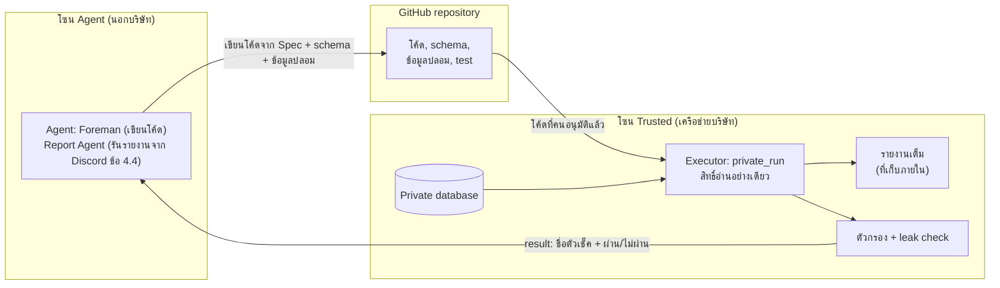
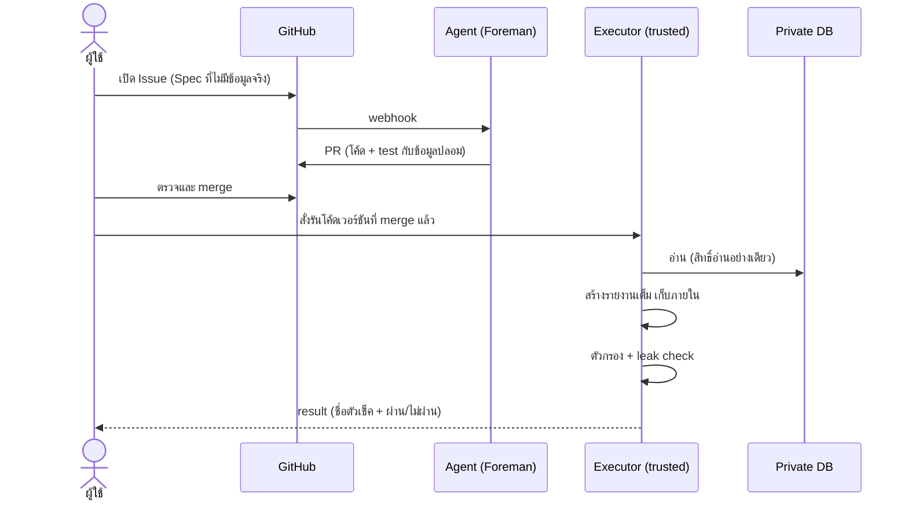
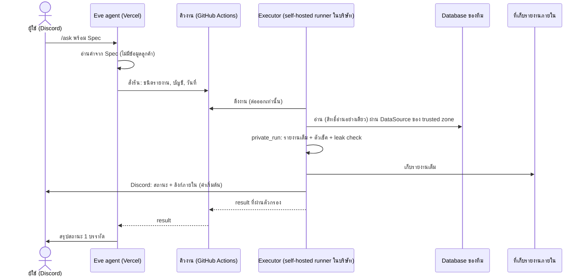
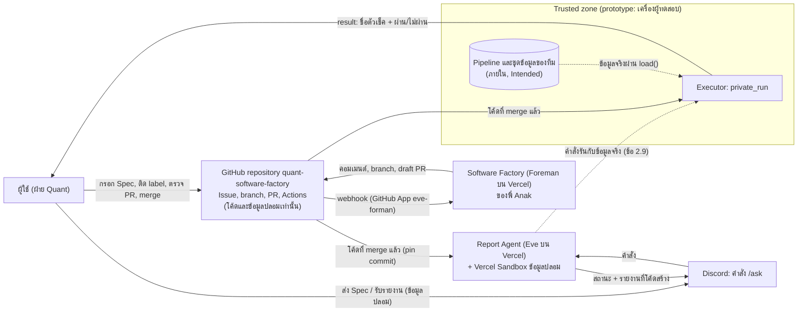
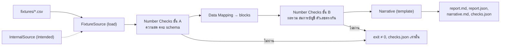
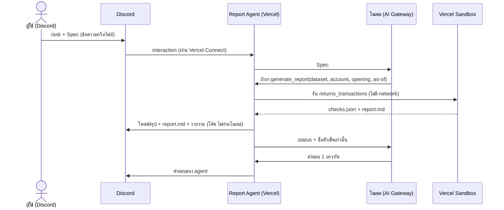
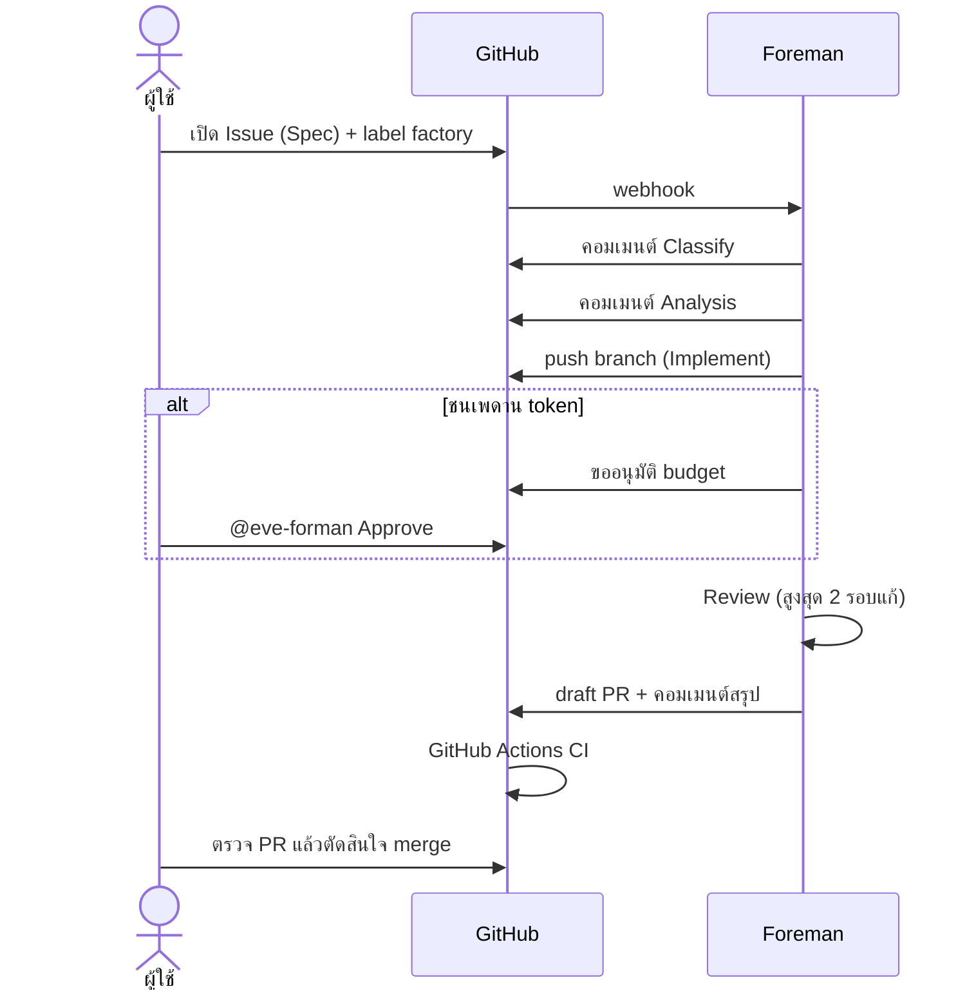

# Reporting Spec Structure for Software Factory: Software Design

- โครงการ: Reusable Report Spec Structure สำหรับ Software Factory ของฝ่าย Quant
- ผู้จัดทำ: Inthanon Ratnavardhana
- มาตรฐานอ้างอิง: ISO/IEC/IEEE 42010:2022 (กรอบอธิบายแบบย่อ ไม่ใช่การรับรองความสอดคล้อง)

| Document Version | Last Updated | Status |
|---|---|---|
| v1.6 | 23 พ.ย. 2569 | Current |

Change Log (ประวัติทุก version ดูได้จาก history ของไฟล์นี้ใน git)

| Version | วันที่ | สิ่งที่เปลี่ยน |
|---|---|---|
| v1.6 | 23 พ.ย. 2569 | Report Agent มี tool `generate_grid_report` ส่ง PDF เข้า Discord sandbox ติดตั้ง fpdf2 ใน venv ตอน prepare (PR #35) ปรับข้อจำกัดในข้อ 9 |
| v1.5 | 23 พ.ย. 2569 | เพิ่มข้อ 5.5 รายงาน Grid Trade Performance (PDF) ตามรูปแบบของทีม: การแตก Spec เป็น 4 Issue, timeline ของ Run #7–#10, การตัดสินใจ และ gap เพิ่มหลักฐานในข้อ 7 และปรับข้อจำกัดในข้อ 9 |
| v1.4 | 22 พ.ย. 2569 | Human Iteration 2: เพิ่มข้อ 4.4 Report Agent และ Discord (ส่วนประกอบ, sequence, การตัดสินใจ, gap ที่พบระหว่างทดสอบ) เพิ่มข้อ 2.9 เส้นทางจาก Discord ถึง executor ในบริษัท (Intended) แก้ C4 Context ให้มี Report Agent ปรับคำตอบคำถามข้อ 3 และ 5 ในข้อ 2.6, Spec Structure v0.4 ในข้อ 3, หลักฐาน, traceability, ข้อจำกัด และต้นทุนต่อรายงานในข้อ 10 |
| v1.3 | 19 พ.ย. 2569 | แก้ C4 Context (ข้อ 4.1) เป็น Discord และให้ข้อมูลจริงไปที่ executor ใน Trusted zone แทน GitHub ระบุว่าการรันเฉพาะโค้ดที่ merge แล้วยังเป็นขั้นตอนของคน (ข้อ 2.8) ตั้งชื่อ Run #5 และ #6 เพิ่มแถวต้นทุนและสถานะต้นทุนต่อรายงาน (ข้อ 10) |
| v1.2 | 19 พ.ย. 2569 | ปิด design gap 3 ข้อจากข้อ 2.7 ด้วย Issue #15 → PR #16 (ตัวกันเขียนลง repo ไม่ขึ้นกับวิธีติดตั้ง, leak check จับทั้งคำ, กำหนด layer `"boundary"`) เพิ่มผลตรวจของผู้จัดทำ ข้อจำกัดของ leak check ที่เหลือ หลักฐาน และ traceability |
| v1.1 | 19 พ.ย. 2569 | เพิ่มข้อ 2 Private Data Architecture (แนวทางที่ศึกษา, ผล research, architecture ที่เสนอ, คำตอบคำถาม 5 ข้อ, ผล prototype Issue #12 → PR #13, การตัดสินใจ) ตาม feedback 19 พ.ย. 2569 เลื่อนเลขหัวข้อเดิมเป็น 3–10 เพิ่ม PD-01 ถึง PD-06 ใน traceability และปรับข้อจำกัด |
| v1.0 | 19 พ.ย. 2569 | เปลี่ยนชื่อจาก Design Prototype และย้ายเข้า `docs/` ใน repo จากฉบับที่ส่งเมื่อ 13 พ.ย. 2569 เนื้อหาเดิม เพิ่มหัว version และแก้ลิงก์ |

## สารบัญ

1. Design Overview
2. Private Data Architecture
3. Spec Structure ในฐานะ I/O contract ของ Factory
4. System Architecture (C4)
5. Agent Workflow และ Sequence
6. Prototype Usage
7. Verification Evidence
8. Traceability
9. Limitations and Future Direction
10. Execution Cost

## 1. Design Overview

เอกสารนี้อธิบายการออกแบบ Report Spec Structure และวิธีที่มันทำงานร่วมกับ Software Factory (Foreman) ของพี่ Anak พร้อมหลักฐานจากต้นแบบ 4 run ใน Iteration 1 ข้อกำหนดอ้างจาก SRS [1]

ตั้งแต่ v1.1 โจทย์หลักของการออกแบบคือให้ agent ทำงานกับ Private Data ได้โดยข้อมูลไม่รั่วออกนอก security boundary (ข้อ 2) ส่วนข้อ 3–10 เป็นการออกแบบ Spec Structure และหลักฐานจาก Iteration 1 ที่ยังใช้อยู่

ตั้งแต่ v1.4 ระบบมี agent 2 ตัวที่ทำงานต่างกัน Foreman เขียนโค้ดรายงานจาก Spec ผ่าน GitHub Issue ส่วน Report Agent (Eve agent ตัวเดียว ข้อ 4.4) รันโค้ดที่ merge แล้วตามคำสั่งจาก Discord ทั้งสองตัวไม่เห็นข้อมูลจริง

แนวคิดหลัก: โรงงานรับ input เป็น GitHub Issue อยู่แล้ว สิ่งที่โครงการนี้ออกแบบคือ**รูปแบบของ Issue** ให้งานรายงานส่งเข้าโรงงานได้ซ้ำๆ แล้วได้ผลที่ตรวจได้ โดยไม่ต้องแก้โรงงาน

| มุมมอง | สิ่งที่อธิบาย |
|---|---|
| Spec Structure | หัวข้อของ Spec, block, preset, Data Mapping, Number Checks, Writing Rules |
| Factory | Foreman รับ Issue แล้วสร้าง draft PR (ไม่ได้ออกแบบในโครงการนี้) |
| คุณภาพ | Expected Values, Number Checks ใน `checks.json`, GitHub Actions CI |
| คน | กรอก Spec, ติด label, อนุมัติเมื่อโรงงานขอ, ตรวจ PR และ merge |

## 2. Private Data Architecture

ส่วนนี้เพิ่มใน v1.1 ตาม feedback วันที่ 19 พ.ย. 2569 ที่กำหนดให้การทำงานกับ Private Data เป็น Core Requirement ของโครงการ ข้อกำหนดอยู่ใน SRS กลุ่ม PD

### 2.1 โจทย์และข้อจำกัด

โจทย์: ให้ agent ช่วยสร้างรายงานจากข้อมูลลูกค้าจริงได้ โดยข้อมูลส่วนตัวหรือข้อมูลลับไม่รั่วออกนอก security boundary

| ข้อจำกัด | ผลต่อการออกแบบ |
|---|---|
| ข้อมูลลูกค้าอยู่ใน database บน server ภายในเครือข่ายบริษัท ไม่ได้อยู่บน cloud | การต่อจาก cloud เข้ามาต้องผ่านเครือข่ายพิเศษ หรือให้ส่วนที่แตะข้อมูลรันในบริษัท |
| ตัวโมเดล (Claude) รันที่ผู้ให้บริการภายนอก | ข้อมูลใดที่อยู่ใน prompt ถือว่าออกนอกบริษัทแล้ว ไม่ว่า agent runtime จะอยู่ที่ไหน |
| repository เป็น public | repo เก็บได้แค่โค้ด schema และข้อมูลปลอม |
| ตัวเลขในรายงานคำนวณไว้แล้วโดย pipeline ของทีม | งานรายงานคือดึง จัดรูป และตรวจตัวเลข ไม่ต้องให้โมเดลตีความค่า |

### 2.2 แนวทางที่ศึกษา

| | A. Bring Data to Agent | B. Bring Agent to Data | C. แยกการคิดออกจากข้อมูล |
|---|---|---|---|
| แนวคิด | agent อยู่บน cloud ที่ควบคุมได้ ส่งข้อมูลหรือบางส่วนไปให้ | agent runtime อยู่ในเครือข่ายบริษัท | agent เขียน query หรือโปรแกรมจาก schema และข้อมูลปลอม executor ในบริษัทเป็นผู้รัน แล้วส่งกลับเฉพาะผลที่ผ่านตัวกรอง |
| ข้อมูลดิบออกนอกบริษัท | ใช่ ไปที่ cloud และผู้ให้บริการโมเดล | ใช่ ถ้าข้อมูลอยู่ใน prompt เพราะโมเดลยังรันข้างนอก | ไม่ |
| ใช้โครงเดิมได้ไหม | บางส่วน การต่อเครือข่ายภายในบน Vercel ต้องใช้ Secure Compute (Enterprise) และ AWS VPC | ต้องตั้งและดูแล agent runtime เอง | ได้ ฝั่งเขียนโค้ดใช้ Foreman หรือ Eve ตามเดิม เพิ่ม executor ในบริษัท |
| ความยาก | กลางถึงสูง (เครือข่าย, สัญญากับผู้ให้บริการ) | สูง (server, ความปลอดภัยของ runtime) | กลาง (executor, ตัวกรอง output, leak check) |
| ข้อจำกัดหลัก | ขึ้นกับสัญญาและ policy ของบริษัท | ยังต้องกันไม่ให้ข้อมูลดิบเข้า prompt | agent ตอบคำถามที่ต้องเห็นค่าจริงไม่ได้ เช่น "ทำไมบัญชีนี้ขาดทุน" |

### 2.3 ข้อค้นพบจาก Research

ค้นจากเอกสารสาธารณะเมื่อ 19 พ.ย. 2569 เงื่อนไขสัญญาจริงของบริษัทยังต้องยืนยันกับฝ่ายที่ดูแล

| Platform | ข้อค้นพบ |
|---|---|
| Vercel / Eve | Sandbox ตั้ง firewall ได้ 3 แบบ (allow-all, deny-all ที่บล็อกแม้แต่ DNS, custom ตาม domain และ CIDR) [8] การต่อ private network ต้องใช้ Secure Compute ซึ่งเป็น Enterprise และ peer กับ AWS VPC [9] ตัวอย่าง Eve + database ของ Vercel เองส่งแถวข้อมูลเต็มให้โมเดลสรุป และ trace อาจเก็บแถวข้อมูลไว้ [10] AI Gateway เปิด Zero Data Retention ได้ ถ้าไม่มีผู้ให้บริการที่ผ่านเงื่อนไข request จะ fail [11] |
| GitHub private repo + self-hosted runner | private repo กันคนนอก แต่ทุกคนที่มีสิทธิ์ใน repo เห็นทุกอย่างที่ commit secret scanning และ push protection สำหรับ org private repo ต้องใช้แผน Team หรือ Enterprise และค่าเริ่มต้นให้คนที่มีสิทธิ์เขียน bypass ได้ [12] self-hosted runner รันงานบนเครื่องของเราเองได้ ข้อแนะนำคือไม่ใช้กับ public repo, จำกัด runner group, ใช้ runner แบบครั้งเดียว และให้คนอนุมัติก่อนรันโค้ดจาก PR [13] |
| ผู้ให้บริการโมเดล | Claude API ไม่ใช้ข้อมูล train ถ้าไม่ได้อนุญาต Zero Data Retention ต้องขอผ่าน sales และบางโมเดลบังคับเก็บข้อมูล 30 วัน [14] Amazon Bedrock ไม่ใช้ข้อมูล train และเก็บข้อมูลใน region ที่ใช้ แต่บางโมเดลมีการเก็บข้อมูลเพื่อตรวจ abuse และมีรายงานปี 2026 เรื่องการแชร์ข้อมูลบางโมเดลกับ Anthropic [15][16] |

ข้อสรุปจาก research: ZDR, Bedrock และ Secure Compute ลดความเสี่ยงได้ แต่ทุกทางที่ให้โมเดลเห็นข้อมูล ข้อมูลยังออกนอกบริษัทไปที่ผู้ให้บริการ ถ้า policy ไม่อนุญาตให้ข้อมูลลูกค้าออกนอกบริษัท ต้องออกแบบให้โมเดลไม่เห็นข้อมูลดิบ

### 2.4 Architecture ที่เสนอ

เสนอแนวทาง C เป็นหลัก เพราะงานรายงานเป็นการดึงตัวเลขที่ pipeline คำนวณไว้แล้วมาจัดตามรูปแบบที่กำหนด โค้ดทำได้โดยไม่ต้องให้โมเดลเห็นค่า แนวทาง A แบบจำกัด (ZDR และข้อมูลที่ลบตัวตนแล้ว) เก็บไว้สำหรับงานที่จำเป็นต้องให้โมเดลเห็นข้อมูลในอนาคต สถานะ: Demonstrated ในระดับ prototype (ข้อ 2.7) ด้วย private database จำลองบนเครื่องผู้ทดสอบ ยังไม่ได้ทดสอบกับ database และเครือข่ายจริงของบริษัท

| ส่วน | หน้าที่ | สิ่งที่ข้ามเส้นได้ |
|---|---|---|
| โซน Agent | อ่าน Spec, schema และข้อมูลปลอม แล้วเขียนโค้ดและ test | ส่งออก: โค้ด |
| Repository | เก็บโค้ด schema และข้อมูลปลอม มีกลไกกัน commit ข้อมูลจริง (`.gitignore`, ตัวเช็ค) | ไม่มีข้อมูลจริง |
| Executor (โซน Trusted) | รันโค้ดที่คนอนุมัติแล้วกับ private database ด้วยสิทธิ์อ่านอย่างเดียว | รับเข้า: โค้ด |
| ที่เก็บรายงาน (โซน Trusted) | เก็บรายงานเต็มที่มีข้อมูลจริง กำหนดสิทธิ์ผู้อ่าน | ไม่ออกนอกโซน |
| ตัวกรองและ leak check | ตัดทุกค่าออกจากผลตรวจ เหลือชื่อตัวเช็คและผ่าน/ไม่ผ่าน และหยุดถ้าพบตัวเลข เลขบัญชี หรือชื่อลูกค้า | ส่งออก: result ที่ผ่านตัวกรอง |

ข้อค้นพบระหว่างออกแบบ: `checks.json` ที่ใช้ตั้งแต่ v1.0 เก็บค่า `expected` และ `actual` ซึ่งเป็นตัวเลขจริง จึงส่งกลับให้ agent ไม่ได้ ต้องผ่านตัวกรองก่อน

### 2.5 Sequence ของการรันใน trusted zone

### 2.6 คำตอบคำถาม 5 ข้อ (ณ v1.1)

| คำถาม | คำตอบ | สถานะ |
|---|---|---|
| 1. Data Security: private repo ปลอดภัยพอไหม | พอสำหรับเก็บโค้ดและข้อมูลปลอม ไม่พอสำหรับเก็บข้อมูลลูกค้า เพราะทุกคนที่มีสิทธิ์ใน repo เห็นทุกอย่างที่ commit ต้องเพิ่มกลไกกัน commit ข้อมูลจริง, secret scanning, branch protection และจำกัดสิทธิ์ | Research |
| 2. Data Movement: ข้อมูลออกจาก server หลักได้ไหม | ออกแบบให้ไม่ต้องออก สิ่งที่ข้ามเส้นมีแค่โค้ด (เข้า) และ result ที่ผ่านตัวกรอง (ออก) prototype แสดงว่ารายงานเต็มอยู่แค่ในโฟลเดอร์ปิด และ result ไม่มีตัวเลข เลขบัญชี หรือชื่อลูกค้า | Demonstrated ใน prototype (ข้อ 2.7) |
| 3. Agent Deployment: deploy ที่ไหน | agent อยู่บน Vercel ได้เพราะไม่เห็นข้อมูล Report Agent deploy แล้วใน Team ของพี่ Anak (ข้อ 4.4) แต่ตัวที่แตะข้อมูลจริงต้องเป็น execution environment แยกในบริษัท ข้อ 2.9 เสนอ self-hosted runner ที่ดึงงานจาก GitHub Actions | Report Agent บน Vercel: Demonstrated กับข้อมูลปลอม; executor ในบริษัท: Intended |
| 4. Execution and Communication: agent สร้างโปรแกรมให้รันในที่ปลอดภัยได้ไหม | ได้ โรงงานเขียน `SqliteSource`, `make_private_db` และ `private_run` จาก Spec ที่ไม่มีข้อมูลจริง (Issue #12) แล้ว executor รันกับ private database ที่ตัวเลข เลขบัญชี และชื่อลูกค้าไม่เคยอยู่ใน repo ได้ผลถูกต้อง และส่งกลับแค่ result | Demonstrated ใน prototype (ข้อ 2.7) |
| 5. Output Artifacts: รายงานที่มีข้อมูลจริงเก็บที่ไหน | เก็บในโซน Trusted เท่านั้น ห้าม commit และห้ามส่งให้ agent prototype ปฏิเสธการเขียน output ลงใน repo (exit 2) กับข้อมูลปลอม Report Agent ส่งรายงานเข้า Discord ด้วยโค้ดโดยโมเดลไม่เห็น (ข้อ 4.4) กับข้อมูลจริง ค่าเริ่มต้นคือ Discord ได้แค่สถานะและลิงก์ภายใน การส่งเนื้อหาเข้า Discord ต้องรอ policy (ข้อ 2.9) | เก็บนอก repo และโมเดลไม่เห็นรายงาน: Demonstrated; สิทธิ์ผู้อ่านและช่องทางสำหรับข้อมูลจริง: Intended |

### 2.7 Prototype: Private data boundary (Run #5, Issue #12)

| | |
|---|---|
| Spec | Issue #12 (Platform Spec ต่อยอดจาก #7 และ #9) |
| สิ่งที่โรงงานสร้าง | `SqliteSource` (อ่าน private database ผ่าน `load(...)` เดิม แบบอ่านอย่างเดียว), `make_private_db` (สร้าง database จาก CSV พร้อมคูณตัวเลขและเปลี่ยนชื่อ เพื่อให้ได้ข้อมูลที่ไม่มีใน repo), `private_run` (executor ที่เขียนรายงานเต็มนอก repo และส่งกลับแค่ result ที่ผ่าน leak check) |
| private database ใน prototype | ไฟล์ SQLite บนเครื่องผู้ทดสอบ แทน database จริงในบริษัท |
| Output | PR #13 merge แล้ว (merge commit `ab61d91`, 19 พ.ย. 2569 07:42 UTC) |
| เวลาโรงงาน | label 07:24:17 → PR 07:39:23 UTC (15 นาที) ไม่ชนเพดาน token ไม่ต้องกด Approve reviewer ไม่ส่งกลับ |
| CI | run 44481298874 ผ่าน Python 3.10–3.13, test 235 กรณี (เดิม 149 + ใหม่ 86) |

ผลการตรวจของผู้จัดทำ (รันเองบน commit `357e1f8` เมื่อ 19 พ.ย. 2569):

| ตรวจ | ผล |
|---|---|
| สร้าง private database ที่คูณตัวเลข 7 เท่า เปลี่ยนเลขบัญชีและชื่อลูกค้าเป็นค่าที่ไม่มีใน repo | สร้างได้ 6 ตาราง |
| executor รันกับ database นั้น | `29 checks, 0 failed` exit 0 รายงานเต็มอยู่ในโฟลเดอร์ปิดนอก repo |
| ตัวเลขในรายงานเต็มหลุดเข้า `result.json` | 0 จาก 34 ตัวเลข เลขบัญชีและชื่อลูกค้าไม่หลุด |
| key ใน `result.json` | `status`, `checks_total`, `checks_failed`, `checks` (`name`, `layer`, `passed`) เท่านั้น |
| ค่าจาก private database อยู่ใน repo หรือ PR | ไม่พบ |
| database หลังรัน | SHA-256 เท่าเดิม (อ่านอย่างเดียว) |
| สั่งให้เขียน output ลงใน repo | ปฏิเสธ exit 2 ไม่สร้างไฟล์ |

หลัง merge ผู้จัดทำรัน Acceptance Test Walkthrough ส่วน B ของ Delivery Document ซ้ำใน clone ใหม่ของ `main` (commit `ab61d91`) ได้ผลตรงทุกขั้น

#### Design gap จาก PR #13 และการแก้ (Run #6, Issue #15 → PR #16)

หลัง merge PR #13 พบ design gap 3 ข้อ Spec ยังใช้ได้ แต่ตัว prototype ทำได้ไม่ครบ จึงเปิด Issue #15 ให้โรงงานแก้โดยไม่ลดข้อกำหนด

| Gap ที่พบ | การแก้ใน PR #16 | สถานะ |
|---|---|---|
| ตัวกันเขียนลง repo หาตำแหน่ง repo จากที่ติดตั้ง package ถ้าติดตั้งแบบไม่ใช่ editable จะไม่กันอะไรเลยโดยไม่แจ้ง | เช็คเพิ่มจาก path ของ output แต่ละตัว ไล่ขึ้นไปหา `pyproject.toml` ของโปรเจกต์นี้ (ตาม symlink และใช้ได้แม้ path ยังไม่มีอยู่) ปฏิเสธ exit 2 ไม่ว่าจะติดตั้งแบบใด | ปิดแล้ว |
| leak check ค้นแบบ substring ทั้งข้อความ เลขบัญชีสั้นชนกับข้อความปกติ เช่น `A1` ชนกับ `A1_freshness_nav_daily` และ `29` ชนกับ `"checks_total": 29` ทำให้หยุดทั้งที่ไม่รั่ว | parse result แล้วค้นเลขบัญชีและชื่อลูกค้าแบบทั้งคำ เฉพาะค่าที่เป็นข้อความ กฎเรื่องตัวเลขที่มีจุดหรือจุลภาคใช้กับทั้งข้อความเหมือนเดิม ข้อความที่ไม่ใช่ JSON ไม่ผ่าน (`unparseable`) | ปิดแล้ว |
| `boundary_leak_check` ใช้ layer `"boundary"` ซึ่ง Spec ไม่ได้กำหนด | README ระบุ layer `"boundary"` ว่าอยู่ใน `checks.json` ฝั่ง private เท่านั้น และไม่อยู่ใน result | ปิดแล้ว |

| | |
|---|---|
| Spec | Issue #15 (Platform Spec ต่อยอด #12) |
| เวลาโรงงาน | label 12:52:42 → PR 13:03:53 UTC (11 นาที) ไม่ชนเพดาน token ไม่ต้องกด Approve reviewer อนุมัติรอบแรก |
| Output | PR #16 merge แล้ว (merge commit `3a422c5`, 19 พ.ย. 2569 13:17 UTC) แก้ 3 ไฟล์ตามที่ Spec อนุญาต |
| CI | PR run 44529767220 และ `main` run 44532003447 ผ่าน Python 3.10–3.13, test 264 กรณี |

ผลการตรวจของผู้จัดทำ (รันเองใน clone ใหม่ของ commit `25addde` ติดตั้งแบบไม่ใช่ editable เทียบกับ `main` ก่อนแก้):

| ตรวจ | ก่อนแก้ (`78e8c32`) | หลังแก้ (`25addde`) |
|---|---|---|
| `--private-out` อยู่ใน clone ของ repo | exit 0 เขียนรายงาน 4 ไฟล์ลง repo | exit 2 ไม่เขียนอะไร |
| `--result` อยู่ในโฟลเดอร์ย่อยที่ยังไม่มีใน clone | ไม่ได้ทดสอบ | exit 2 ไม่เขียนอะไร |
| `--private-out` ผ่าน symlink ที่ชี้เข้า clone | ไม่ได้ทดสอบ | exit 2 |
| บัญชี `A1` และ `29` | exit 3 | exit 0 |
| บัญชี `A` (ชื่อเดียวกับ layer) | exit 3 | exit 3 ตามที่ README ระบุ |
| Walkthrough ส่วน B (คูณ 7 เท่า) | exit 0 | exit 0 ตัวเลขในรายงานเต็มเท่าเดิม `result.json` เหมือนเดิมทุก byte ไม่มีค่าจาก private database |

หลัง merge ผู้จัดทำรัน Acceptance Test Walkthrough ส่วน A และ B ของ Delivery Document ซ้ำใน clone ใหม่ของ `main` (commit `3a422c5`) ได้ผลตรงทุกขั้น

ข้อจำกัดของ leak check ที่ยังเหลือ (ยอมรับไว้ใน Spec ของ Issue #15):
- ไม่ค้นในชื่อ key ของ JSON ถ้าโค้ดในอนาคตใส่เลขบัญชีเป็น key ตัวเช็คจะไม่จับ ตอนนี้ key ถูกกำหนดตายตัวใน `build_result` จึงยังไม่รั่ว
- ไม่ค้นในค่าจำนวนเต็ม เลขบัญชีที่เป็นตัวเลขล้วนถ้าไปอยู่ในค่าจำนวนเต็มจะไม่ถูกจับ นี่เป็นราคาของการแก้ปัญหาบัญชี `29`
- เลขบัญชีหรือชื่อลูกค้าที่ตรงกับชื่อตัวเช็คหรือ layer ทั้งคำ (เช่น `A`) ยังทำให้หยุดด้วย exit 3 ฝั่งปลอดภัย

### 2.8 การตัดสินใจและ trade-off

| การตัดสินใจ | เหตุผล | ข้อเสียที่ยอมรับ |
|---|---|---|
| ใช้แนวทาง C เป็นหลัก | ข้อมูลไม่ออกนอกบริษัท ไม่ขึ้นกับสัญญาของผู้ให้บริการโมเดล และเข้ากับหลัก "agent เขียนโค้ด โค้ดคำนวณตัวเลข" ที่ใช้มาตั้งแต่ Iteration 1 | agent ตอบคำถามเชิงวิเคราะห์ที่ต้องเห็นค่าจริงไม่ได้ |
| ใน v1.1 ใช้ Foreman เป็นโซน Agent | ยังไม่มีที่ deploy Eve agent ตัวเดียว และ boundary ออกแบบให้ไม่ขึ้นกับว่าโซน Agent เป็นอะไร | ซับซ้อนกว่าที่จำเป็น อาจชนเพดาน token และดูค่าใช้จ่ายเองไม่ได้ ตั้งแต่ v1.4 งานรันรายงานจากแชตย้ายไป Report Agent แล้ว (ข้อ 4.4) Foreman ใช้เฉพาะงานเขียนโค้ด |
| ใช้ SQLite แทน database จริงใน prototype | ไม่ต้องมีสิทธิ์เข้าระบบภายใน และพิสูจน์ boundary ได้ครบ | ยังไม่ได้ทดสอบ driver, เครือข่าย และสิทธิ์ของ database จริง |
| executor รันเฉพาะโค้ดที่คน merge แล้ว | กันโค้ดที่ยังไม่ผ่านการตรวจเข้าถึงข้อมูลจริง | เพิ่มขั้นตอนของคน ใน prototype เป็นขั้นตอนที่คนต้องทำเอง `private_run` ไม่ได้ตรวจว่าโค้ดที่รันมาจาก commit ที่ merge แล้ว การบังคับด้วยระบบ (เช่น runner ที่ checkout เฉพาะ `main`) เป็น Intended |

### 2.9 เส้นทางจาก Discord ถึง executor ในบริษัท (ออกแบบแล้ว ยังไม่ได้ทำ: Intended)

ที่มา: review เมื่อ 22 พ.ย. 2569 พบว่า Eve agent ที่ deploy แล้ว (`report-agent/`) รันใน Vercel Sandbox ที่ region iad1 ส่วน database ของทีมอยู่ในเครือข่ายภายใน sandbox จึงเข้าไม่ถึง และไม่ควรเข้าถึง ส่วน `private_run` ยังรันด้วยมือบนเครื่องผู้ทดสอบ ยังไม่มีทางให้คำสั่งจาก Discord ไปถึง executor

หลักที่ใช้ต่อจากข้อ 2.4:
1. สิ่งที่ออกจากโซน Agent มีแค่คำสั่งรัน: ชนิดรายงาน บัญชี opening date และ as-of date ไม่มีข้อมูลลูกค้า
2. executor ในบริษัทเป็นฝ่ายต่อออกไปรับงาน (outbound) ไม่เปิดช่องให้ใครต่อเข้ามา
3. agent ได้รับแค่ result ที่ผ่าน leak check เหมือนข้อ 2.7 ซึ่งตอนนี้ agent ที่ deploy แล้วก็ทำแบบเดียวกันกับข้อมูลปลอม: tool ส่งรายงานเข้า Discord เอง และโมเดลเห็นแค่สถานะกับชื่อตัวเช็ค
4. รายงานเต็มอยู่ในโซน Trusted ส่วนจะส่งเนื้อหาเข้า Discord ได้หรือไม่ เป็นการตัดสินใจเชิง policy (ดูตารางคำถามท้ายข้อนี้)

ทางเลือกของคิวงาน:

| ทางเลือก | ข้อดี | ข้อเสีย | ข้อเสนอ |
|---|---|---|---|
| GitHub Actions `workflow_dispatch` + self-hosted runner ในบริษัท | runner ต่อออกไป GitHub เอง ไม่ต้องเปิด firewall ขาเข้า มีตัวอย่างแล้วใน PR #3 ของพี่ Anak (รันสคริปต์ที่อยู่ใน allowlist, checkout โค้ดตาม SHA) บังคับให้รันเฉพาะโค้ดบน `main` ได้ (ปิด trade-off ข้อสุดท้ายของข้อ 2.8) | GitHub แนะนำไม่ให้ใช้ self-hosted runner กับ public repo [13] ต้องย้ายไป private repo หรือ repo ใหม่ที่พี่ Anak เตรียมไว้ | เลือกทางนี้ |
| executor ดึงงานจากคิวบน Vercel | ไม่ผูกกับ GitHub | ต้องสร้างและดูแลคิวกับ auth เอง | สำรอง |
| agent เรียก executor ตรงผ่าน URL ภายใน | ง่ายที่สุด | ต้องเปิดช่องให้ต่อเข้าเครือข่ายบริษัทจาก cloud (Secure Compute เป็น Enterprise [9]) | ไม่เลือก |

ทางส่งรายงานถึงผู้ใช้:

| ทางเลือก | ข้อมูลลูกค้าออกนอกบริษัท | หมายเหตุ |
|---|---|---|
| Discord ได้แค่สถานะและลิงก์ไปที่เก็บภายใน (ค่าเริ่มต้น) | ไม่ | ผู้ใช้ต้องอยู่ในเครือข่ายบริษัทหรือ VPN จึงเปิดรายงานได้ |
| executor โพสต์รายงานเต็มเข้า Discord (แบบที่ agent ทำกับข้อมูลปลอมตอนนี้) | ใช่ ไปที่ Discord | ใช้ได้เมื่อ policy อนุญาตเท่านั้น ข้อดีคือใช้จากมือถือได้ครบ |

ต้องได้คำตอบก่อนเริ่มทำ:

| เรื่อง | ถามใคร |
|---|---|
| ส่งเนื้อหารายงานลูกค้าเข้า Discord ได้หรือไม่ หรือส่งได้แค่สถานะกับลิงก์ | พี่ Anak (และฝ่ายที่ดูแล policy) |
| เครื่องในบริษัทที่ใช้เป็น runner และอนุญาตให้ต่อออกไป `github.com` กับ `discord.com` ได้ไหม | พี่ Anak / พี่ Fong |
| บัญชี database แบบอ่านอย่างเดียว และ mapping จากชุดข้อมูล 6 ตัวไปยังตารางและคอลัมน์จริง (เก็บนอก repo) | พี่ Fong |
| repo ที่ใช้กับ self-hosted runner (private) | พี่ Anak |
| ที่เก็บรายงานภายในและสิทธิ์ผู้อ่าน | พี่ Anak |

สิ่งที่ตรวจไว้แล้วระหว่าง review (ระดับชื่อตารางในแผนผังแหล่งข้อมูลของ pipeline ยังไม่ได้ดูคอลัมน์): ชุดข้อมูลทั้ง 6 ตัวมีตารางผลลัพธ์ของ pipeline ที่น่าจะตรงกัน แต่มี 3 จุดที่ schema ปัจจุบันยังไม่รองรับ คือ (1) ฝาก/ถอนหุ้นและการถอนกำไร ซึ่งถ้ามีจะทำให้ตัวเช็ค B5 ไม่ผ่าน (2) ปันผลในข้อมูลจริงอาจไม่อยู่ในรูปรายการที่มีจำนวนหุ้นและราคา (3) วันเริ่มลงทุนยังไม่พบแหล่ง ทั้งหมดเป็น Specification gap ของ Platform Spec รอบถัดไป

## 3. Spec Structure ในฐานะ I/O contract ของ Factory

### 3.1 หัวข้อของ Spec กับสถานีที่ใช้

| หัวข้อใน Spec | Classifier | Analyst | Implementer | Reviewer |
|---|:-:|:-:|:-:|:-:|
| Background, Report Definition | ✓ | ✓ | ✓ | |
| Data Sources (ชื่อกลาง), Data Mapping | | ✓ | ✓ | ✓ |
| Report Blocks, Output Contract | | ✓ | ✓ | ✓ |
| Expected Values | ✓ (ตรวจว่าลงตัว) | | ✓ (เขียน test) | ✓ |
| Number Checks, Writing Rules | | ✓ | ✓ | ✓ |
| Constraints (base branch, dependency) | ✓ | ✓ | ✓ | ✓ |
| Out of Scope, Open Items | ✓ | | | ✓ |
| Acceptance Criteria, Definition of Done | | | | ✓ |

หลักฐาน: ใน Run #1 classifier ตรวจตาราง Expected Values กับ fixture แล้วว่าทุกแถวลงตัว และ reviewer ติ๊ก Acceptance Criteria ครบ 13 ข้อใน PR #5 ใน Run #3 classifier ชี้จุดผิดในนิยามตัวเช็ค (A1 กับ `holdings_daily`) ได้ก่อนเขียนโค้ด

### 3.2 การออกแบบสามรุ่น

| เรื่อง | Template v0.1 (Run #1) | Template v0.2 (Run #2) | เหตุที่เปลี่ยน |
|---|---|---|---|
| ข้อมูลเข้า | ธุรกรรมดิบ ให้โรงงานคำนวณ | ชุดข้อมูลที่คำนวณแล้ว อ้างด้วยชื่อกลาง | ทีมยืนยันว่า pipeline คำนวณตัวเลขไว้แล้ว (specification gap) |
| นิยามตัวเลข | Metric Definitions (สูตร) | Data Mapping (field ต้นทาง) | เหมือนข้างบน |
| การอ่านข้อมูล | อ่าน CSV ตรงๆ | `load(dataset, as_of, accounts)` | ให้เปลี่ยนเป็นข้อมูลจริงได้โดยไม่แก้โค้ดรายงาน |
| ตัวเช็ค | 3 ชั้น (input, บัญชี, เทียบคำตอบ) | ชั้น A ข้อมูล, ชั้น B รายงาน | แยกส่วนที่ pipeline มีอยู่แล้วออกจากส่วนที่โรงงานต้องเขียน |
| Base branch | ไม่ระบุ | ระบุ + `Depends on` | Run #1 แตก branch จาก PR อื่น |
| ข้อมูลหัวรายงาน | ไม่กำหนด (โรงงาน hard-code) | ต้องมาจาก `account_info` | Run #1 |
| ขนาด | ไม่เกิน ~8 block | ไม่เกิน 5–6 block | Run #1 ชนเพดาน token |

Template v0.3 (Run #3 และ #4) ใช้โครงของ v0.2 แต่เปลี่ยน 2 เรื่อง ฉบับรวมที่ใช้งานได้อยู่ใน [`spec-structure/report-spec-structure.md`](spec-structure/report-spec-structure.md) และ [`spec-structure/platform-spec-structure.md`](spec-structure/platform-spec-structure.md)

| เรื่อง | v0.2 | v0.3 | เหตุที่เปลี่ยน |
|---|---|---|---|
| ชนิดของ Spec | ใบเดียว หรือแตกตามชั้นงาน 3 ใบ | Platform Spec (ทำครั้งเดียว) + Report Spec (1 ใบต่อรายงาน 1 ฉบับ) | Run #2 ชนเพดาน และการแตก 3 ใบทำให้ "กรอก 1 ใบได้รายงาน 1 ฉบับ" ไม่เป็นจริง |
| กติกาตัวเช็ค | A2 บังคับทุกชุดข้อมูล, B8 ขัดกับ Writing Rules | ชุดข้อมูลที่ว่างได้, B8 ตรวจเฉพาะเงินและ % และยอมรับค่าสัมบูรณ์ | spec gap จาก Run #2 |

v0.4 (22 พ.ย. 2569, ยังไม่ได้รันกับโรงงาน) แก้ spec gap 2 ข้อจาก review เทียบกับแผนผังแหล่งข้อมูลของ pipeline: ช่อง Data Sources ระบุแค่ชื่อกลางและเลือกที่มาของข้อมูลตอนรัน เพื่อให้ใช้ Spec เดิมกับข้อมูลจริงได้ และกฎ standard library ใช้กับโค้ดรายงานเท่านั้น เพื่อให้ adapter ของ database ใน trusted zone ใช้ driver ได้ ฉบับ v0.3 เก็บไว้ที่ [`history/report-spec-structure-v0.3.md`](history/report-spec-structure-v0.3.md)

### 3.3 Block และ preset

Block มาตรฐานได้จากการแตกรายงานตัวอย่างของทีม 3 ฉบับ (รายละเอียดใน Template v0.1 ภาคผนวก A) preset ของรายงานแต่ละประเภทคือการเลือก block ชุดหนึ่ง รายงาน 3 ประเภทจึงใช้ Spec Structure เดียวกัน ต่างกันแค่ preset, Data Sources และ Expected Values

## 4. System Architecture (C4)

### 4.1 System Context

ข้อมูลจริงไม่เข้า GitHub และไม่ผ่านโรงงาน โค้ดจาก repository ถูกนำไปรันใน Trusted zone แล้วส่งกลับแค่ result (ข้อ 2.4) Report Agent ใช้โค้ดชุดเดียวกันกับข้อมูลปลอมใน Vercel Sandbox เส้นประคือส่วนที่ยังเป็น Intended

### 4.2 Container

| ส่วน | บทบาท | สิ่งที่สาธิตและจุดตรวจหลักฐาน |
|---|---|---|
| Spec Structure | I/O contract ของงานรายงาน | ฉบับใช้งาน: [`spec-structure/report-spec-structure.md`](spec-structure/report-spec-structure.md), [`spec-structure/platform-spec-structure.md`](spec-structure/platform-spec-structure.md); ประวัติ: [`history/report-spec-template.md`](history/report-spec-template.md), [`history/report-spec-template-v0.2.md`](history/report-spec-template-v0.2.md), [`history/report-spec-template-v0.3.md`](history/report-spec-template-v0.3.md) |
| GitHub Issue | Spec ที่กรอกแล้ว + trigger | Issue #4, #6, #7, #9 |
| GitHub App `eve-forman` | connector ระหว่าง repository กับโรงงาน | คอมเมนต์ของ `eve-forman[bot]` ใน Issue #4, #6, #7, #9 |
| Foreman บน Vercel | ประสาน classifier, analyst, implementer, reviewer (Claude Opus 5.5 ทุกสถานี ตาม `agent/lib/models.ts` ของ template) | ลำดับคอมเมนต์ใน Issue |
| Branch + draft PR | Output ของโรงงาน | PR #5, #8, #10 |
| GitHub Actions | ตรวจคุณภาพภายนอกโรงงาน | CI run 43151748082, 43383851475, 43395249810 |
| `checks.json` | ผลตัวเช็คตัวเลขขณะรัน | `reports/demo_coop_rg_2026_10/checks.json` ใน PR #5, `reports/demo_coop_rg_2026_10_v2/checks.json` บน `main` |

### 4.3 Component (โค้ดที่ Spec สั่งให้โรงงานสร้าง ตาม Template v0.2 และ v0.3)

ใน v0.3 แผนภาพนี้สร้างจริงแล้วบน `main` (Run #3 และ #4) ยกเว้น `InternalSource`

| Component | Module บน `main` | มาจาก |
|---|---|---|
| FixtureSource, `DataSource`, schema registry | `reporting/source.py`, `reporting/schema.py` | Platform Spec (PR #8) |
| Number Checks ชั้น A | `reporting/checks.py`, `reporting/check_data.py` | Platform Spec (PR #8) |
| Data Mapping → blocks, CLI | `reporting/returns_transactions.py` | Report Spec (PR #10) |
| Number Checks ชั้น B และตัวเช็คการเขียน | `reporting/report_checks.py` | Report Spec (PR #10) |
| Narrative | `reporting/narrative.py` | Report Spec (PR #10) |

### 4.4 Report Agent และ Discord (Human Iteration 2)

Report Agent คือ Eve agent ตัวเดียวใน [`report-agent/`](../report-agent/) ที่รับ Spec ทาง Discord แล้วส่งรายงานกลับในช่องเดิม agent ไม่เขียนโค้ดและไม่คำนวณตัวเลข มันอ่านค่าจาก Spec แล้วรันโค้ดรายงานที่ merge แล้วบน `main`

| ส่วน | ไฟล์ | หน้าที่ |
|---|---|---|
| Agent | `agent/agent.ts`, `agent/instructions.md` | โมเดล `anthropic/claude-opus-5.5` ผ่าน AI Gateway ปิด tool ที่ eve มีให้ทั้งหมด (bash, ไฟล์, web) เหลือ 2 tool ด้านล่าง หยุด session ที่ใช้เกิน 20K output token |
| Sandbox | `agent/sandbox.ts` | Vercel Sandbox ตอน build clone repository นี้ที่ commit `a1e147a` เก็บใน snapshot ตอนรันปิด network ทั้งหมด |
| `generate_report` | `agent/tools/generate_report.ts` | รัน `returns_transactions` ใน sandbox อ่าน `checks.json` และ `report.md` ถ้าผ่านทุกตัวเช็ค โพสต์รายงานเข้า Discord เอง ส่งให้โมเดลแค่สถานะ จำนวน และชื่อตัวเช็คที่ไม่ผ่าน (`toModelOutput`) |
| `read_spec_file` | `agent/tools/read_spec_file.ts` | อ่านไฟล์ Spec ที่แนบใน Discord ได้เฉพาะไฟล์ข้อความในโฟลเดอร์ไฟล์แนบของ eve ไม่เกิน 50,000 ตัวอักษร |
| การส่งรายงาน | `agent/lib/discord-report.ts` | ข้อความสรุปพร้อม `report.md` แนบ แล้วตามด้วยรายงานเป็นข้อความ ตารางอยู่ใน code block และเติมช่องว่างให้คอลัมน์ตรง (เปลี่ยนแค่ช่องว่าง มี test ยืนยันว่าทุก cell เหมือนเดิม) |
| Discord channel | `agent/channels/discord.ts`, `agent/discord-credentials.ts` | slash command `/ask` (ช่อง `message` และ `file`) token อยู่ใน Vercel Connect connector ไม่อยู่ใน repo |

การตัดสินใจ:

| การตัดสินใจ | เหตุผล | ข้อเสียที่ยอมรับ |
|---|---|---|
| Eve agent ตัวเดียว แทนการส่ง Issue เข้า Foreman จาก Discord | โค้ดรายงานมีอยู่แล้ว การสร้างรายงานจึงเป็นการรันโค้ด ไม่ใช่การเขียนโค้ด agent ตัวเดียวจบใน 15–30 วินาที ไม่ชนเพดาน token และวัดค่าใช้จ่ายต่อรายงานได้ ตามที่ weekly report ข้อ 2 แนะนำให้เริ่มจากระบบที่ง่ายที่สุด | รายงานชนิดใหม่ยังต้องเขียนโค้ดผ่าน Foreman ก่อน แล้วจึงเพิ่มเข้า Report Agent |
| tool โพสต์รายงานเอง โมเดลเห็นแค่สถานะ | ตัวเลขไม่ผ่านโมเดล (HR-06, เข้ากับแนวทาง C ข้อ 2.4) และไม่มีความเสี่ยงที่โมเดลพิมพ์ตัวเลขผิด ค่าโมเดลต่อรายงานลดจากประมาณ $0.048 เหลือประมาณ $0.014 เพราะโมเดลไม่ต้องพิมพ์รายงานซ้ำ | ถ้าโพสต์ไม่สำเร็จ โมเดลรู้แค่ข้อความ error เนื้อหาไปถึง Discord ซึ่งรับได้กับข้อมูลปลอมเท่านั้น |
| slash command แทนการ mention bot | ไม่ต้องมี process ที่รันตลอด (โหมด mention ต้องใช้ Gateway relay ที่รันบน Vercel Daemon ซึ่ง eve ระบุว่ายังเป็น experimental) | ผู้ใช้ต้องพิมพ์ `/ask` ไม่ได้คุยต่อในเธรด |
| pin โค้ดรายงานที่ commit และปิด network ของ sandbox | รายงานรันซ้ำได้และตรวจย้อนได้ว่ามาจากโค้ดเวอร์ชันไหน โค้ดใน sandbox ส่งข้อมูลออกไม่ได้ | แก้โค้ดรายงานแล้วต้องเปลี่ยน commit และ deploy ใหม่ |
| ไม่มี tool ที่ eve ให้มา (bash, อ่าน/เขียนไฟล์, web) | โมเดลคำนวณหรือแก้ตัวเลขใน sandbox ไม่ได้ ทางเดียวที่ได้รายงานคือ `generate_report` | ต้องเขียน `read_spec_file` เองเพื่ออ่านไฟล์แนบ |

Gap ที่พบระหว่างทดสอบบน Vercel และ Discord (22 พ.ย. 2569):

| Gap | ประเภท | การแก้ | สถานะ |
|---|---|---|---|
| Report ID ในรายงานเป็นชื่อโฟลเดอร์สุ่ม เพราะโค้ดรายงานใช้ชื่อโฟลเดอร์ output เป็น Report ID | Design | ตั้งชื่อโฟลเดอร์ตาม dataset ผลรอบถัดไปตรงกับ `report.md` ใน repo ทุก byte | ปิดแล้ว ยังเหลือว่า Report ID ควรมาจากช่อง Report ID ของ Spec |
| แนบไฟล์ Spec แล้ว agent ตอบว่าเปิดไฟล์ไม่ได้ เพราะปิด tool อ่านไฟล์ไว้ | Design | เพิ่ม `read_spec_file` ที่อ่านได้เฉพาะไฟล์แนบ | ปิดแล้ว รอบถัดไปได้ 29/29 |
| โมเดลได้รายงานทั้งฉบับแล้วพิมพ์ซ้ำลง Discord ตัวเลขจึงผ่านโมเดลและไม่มีอะไรตรวจสำเนา | Design (จาก review เทียบกับ feedback 19 พ.ย.) | tool โพสต์รายงานเองและซ่อนจากโมเดล | ปิดแล้ว ไฟล์แนบมี SHA-256 ตรงกับ `report.md` |
| Discord ไม่แสดงตาราง Markdown ตารางขึ้นเป็น `\|` ดิบ | Design | ครอบตารางด้วย code block และเติมช่องว่าง แนบ `report.md` เดิมไว้ด้วย | ปิดแล้ว บนมือถือตารางกว้างต้องเลื่อนข้าง |
| agent ตอบว่ารายงาน "อยู่ด้านบน" แต่รายงานอยู่ใต้คำตอบ | Design | แก้ข้อความใน instructions | แก้และ deploy แล้ว ยังไม่ได้ดูผลใน Discord |
| agent อ่านจาก Spec แค่ 4 ค่า ส่วนอื่นของ Spec ไม่มีผล | Specification | บอกผู้ใช้เมื่อ Spec ขอสิ่งที่โค้ดไม่ทำ (instructions ข้อ 7) | ยังเปิด |

## 5. Agent Workflow และ Sequence

### 5.1 Run #1 (Issue #4, 12 พ.ย. 2569, UTC)

| ขั้น | เวลา | ระยะ | ผล |
|---|---|---|---|
| ติด label | 03:27:08 | | |
| Classify | 03:28:39 | ~1.5 นาที | ผ่าน ตรวจ Expected Values ลงตัว |
| Analysis | 03:34:56 | ~6 นาที | แผน + 4 จุดที่ตัดสินใจเอง |
| Implement | ถึง 03:43:52 | ~9 นาที | push 4 commit แล้วชนเพดาน 100K token |
| รอคนอนุมัติ | 03:43:52 ถึง 03:54:49 | ~11 นาที | ผู้ใช้ตอบ Approve |
| Review + เปิด PR | 03:58:53 | ~4 นาที | reviewer อนุมัติรอบแรก |
| CI | 03:59:20 | | ผ่าน 4 เวอร์ชัน |
| รวม | | 31 นาที 45 วินาที | |

ระยะเวลาคิดจาก timestamp ของคอมเมนต์และ event ใน GitHub ไม่ใช่ log ภายในของโรงงาน

### 5.2 Run #2 (Issue #6)

| ขั้น | เวลา (UTC) | ผล |
|---|---|---|
| ติด label | 12 พ.ย. 09:24:32 | |
| Classify | 09:26:22 | ผ่าน ยืนยันว่าแตก branch จาก `main` + 2 จุดที่ตัดสินใจเอง (รูปแบบวันที่, B4) |
| Analysis | 09:32:07 | แผน + 3 จุดที่ตัดสินใจเอง + 2 คำถาม |
| Implement | 09:39:44 | ชนเพดาน 44.9K token ไม่มี push |
| Approve | 12 พ.ย. 09:41:51 และ 13 พ.ย. 06:17 | โรงงานไม่ตอบสนอง |
| ปิด Issue | 13 พ.ย. 06:48:48 | not planned แล้วแตกเป็น Spec v0.3 |

### 5.3 Run #3 และ Run #4 (Issue #7 และ #9, 13 พ.ย. 2569, UTC)

| ขั้น | Run #3 (Platform Spec) | Run #4 (Report Spec) |
|---|---|---|
| ติด label | 06:58:00 | 07:16:19 |
| Classify | 06:59:22 | 07:17:34 |
| Analysis | 07:02:59 | 07:22:36 |
| Implement push | 07:07:22 | 07:31:55 (29 checks ผ่าน) |
| ชนเพดาน token | ไม่ชน | 07:32:06 (100K) ก่อนขั้น review |
| Approve | ไม่ต้อง | 08:38:30 |
| Review + เปิด PR | 07:10:34 | 08:41:51 reviewer อนุมัติรอบแรก |
| Merge (คน) | 07:13:08 | 08:43:45 |
| รวม label ถึง PR | 12 นาที 34 วินาที | 85 นาที 32 วินาที (รอคน 66 นาที 24 วินาที, โรงงานทำงานประมาณ 19 นาที) |

### 5.4 Sequence

จุดที่คนเกี่ยวข้อง: เขียน Spec, ติด label, อนุมัติเมื่อชนเพดาน, ตรวจและ merge การอนุมัติกลางทางไม่ได้อยู่ในการออกแบบเดิม เป็นผลจากเพดาน token (ดูข้อ 9)

### 5.5 รายงาน Grid Trade Performance (Issue #23 → Run #7–#10, 23 พ.ย. 2569)

ตอบ feedback ต่อ PR #5 ที่ขอ "รายงานจริง" ไม่ใช่ infrastructure: Input คือ Issue #23 ที่มี Report Spec ของรายงาน Reverse Grid แบบเดียวกับที่ทีม Quant ส่งลูกค้า (PDF 5 หน้า: Summary Performance, Transaction และหน้ารายหุ้นพร้อมกราฟ 2 อัน) Output คือ `reports/demo_grid_2026_11/report.pdf`

ขั้นตอน:
1. ผู้จัดทำสร้างข้อมูลปลอม (PR #22) และคำนวณค่าที่คาดหวังด้วยสคริปต์แยกจากโค้ดรายงาน แล้วใส่ไว้ใน Spec
2. เปิด Issue #23 โรงงานวิเคราะห์ผ่านและยืนยันว่าค่าที่คาดหวังทุกแถวคำนวณจากข้อมูลได้ แต่ชน budget 21.7K output token ต่อ session ก่อน implement และหลัง approve ไม่ทำต่อภายใน 43 นาที
3. สั่งหยุดแล้วแตก Spec เป็น 4 Issue ที่แต่ละอันจบใน session เดียว แต่ละ PR merge ก่อนเปิด Issue ถัดไป

| Run | Issue → PR | ขอบเขต | label ถึง push | หมายเหตุ |
|---|---|---|---|---|
| #7 | #25 → #26 | ลงทะเบียน `grid_setup`, `grid_cash` และกันรายงานเดิมด้วย `RETURNS_DATASETS` | 8 นาที (PR ที่ 9 นาที) | ไม่ต้อง approve |
| #8 | #27 → #28 | ตัวเลขทุกค่า, ตัวเช็ค G0–G9, `report.json` | 13 นาที | ชน guardrail หลัง push, approve แล้วไม่ตอบ 14 นาที ผู้จัดทำเปิด PR จาก branch ของโรงงานโดยไม่แก้โค้ด และตรวจค่าที่คาดหวังเองแทนขั้น review |
| #9 | #29 → #30 | fpdf2, PDF หน้า 1–2 จาก `report.json` | 16 นาที (PR ที่ 20 นาที) | ไม่ต้อง approve |
| #10 | #31 → PR #32 | หน้ารายหุ้น 3–5, กราฟ, G10, แก้ตัวหนาจากการตรวจ PR #30 ปิด #23 | 19 นาที (PR ที่ 22 นาที) | ไม่ต้อง approve ผู้จัดทำเปิด PDF ตรวจทุกหน้าก่อน merge |

การตัดสินใจ:
- **โค้ดคำนวณก่อน แล้ววาดทีหลัง** `report.json` เก็บทุกค่าที่พิมพ์ใน PDF เป็นข้อความที่จัดรูปแบบแล้ว ตัววาด PDF (`grid_pdf.py`) อ่านจาก `report.json` อย่างเดียว ตัวเช็คจึงตรวจตัวเลขได้โดยไม่ต้องอ่าน PDF
- **fpdf2 แทน WeasyPrint** fpdf2 เป็น Python ล้วน ไม่ต้องมี Pango ในเครื่องของโรงงานและ CI ทดสอบก่อนแล้วว่าสร้างซ้ำได้ไฟล์เหมือนเดิม ข้อเสียคือต้องกำหนดตำแหน่งเองทั้งหมด กฎ standard library ยังใช้กับส่วนคำนวณและตัวเช็ค
- **PDF ไม่บีบอัด** (`compress = False`) และวันที่สร้างมาจาก `--generated-at` เพื่อให้ไฟล์เหมือนกันทุก byte บน Python 3.10–3.13 (โรงงานเสนอในขั้นวิเคราะห์)
- **จำลองการดึงจาก database** test สร้าง SQLite จาก CSV ชุดเดียวกันแล้วรันผ่าน `SqliteSource` ต้องได้ไฟล์เหมือนกัน เมื่อได้สิทธิ์ข้อมูลจริงจะเปลี่ยนแค่ตัว source
- **ไม่มีโลโก้และใช้ disclaimer ที่เขียนเอง** เพราะ repository เป็น public

Gap:
- งานใหญ่เกิน budget ต่อ session ของโรงงาน และ approve แล้วไม่ทำต่อ 2 ครั้ง (#23, #27): Design gap ของขนาดงานต่อ Issue แก้โดยแตก Issue
- PR #28 มีคำว่า "do not close #23" GitHub อ่านเป็นคำสั่งปิด #23: เปิด #23 ใหม่ และหลีกเลี่ยงคำว่า close/fix/resolve ตามด้วยเลข Issue ใน PR ที่ไม่ได้ตั้งใจปิด
- สูตร Expected Volume, NAV Vol และ Cost Change % อนุมานจากรายงานตัวอย่าง ยังไม่ได้ยืนยันกับทีม Quant

## 6. Prototype Usage

0. ถ้า repository ยังไม่มี data layer ให้เปิด Platform Spec ก่อนแล้ว merge (ทำครั้งเดียว ใน Iteration 1 คือ Issue #7) ช่องกรอกอยู่ใน [`spec-structure/platform-spec-structure.md`](spec-structure/platform-spec-structure.md) ข้อ 6
1. คัดลอกช่องกรอกจาก [`spec-structure/report-spec-structure.md`](spec-structure/report-spec-structure.md) ข้อ 11 แล้วเลือก preset ของรายงานจากข้อ 7 ของไฟล์เดียวกัน ตัวอย่างที่กรอกแล้วอยู่ใน [`specs/report-spec.md`](specs/report-spec.md)
2. กรอก Report Definition, Data Sources (fixture ปลอม), Data Mapping, Report Blocks และ Expected Values ที่คำนวณไว้แล้ว
3. ตรวจว่าไม่มีข้อมูลจริงหรือชื่อระบบภายใน และ fixture ผ่านตัวเช็คทุกข้อ (ผู้จัดทำตรวจด้วยสคริปต์ก่อนเปิด Issue ทุกรอบ)
4. เปิด Issue แล้วติด label `factory` ด้วยบัญชีคน
5. ติดตามคอมเมนต์ของ `eve-forman[bot]` และตอบ `@eve-forman Approve` ถ้าโรงงานขอ
6. ตรวจ PR: Expected Values, `checks.json`, `report.md`, CI แล้วตัดสินใจ merge

## 7. Verification Evidence

| หลักฐาน | ลิงก์ / ค่า | พิสูจน์อะไร |
|---|---|---|
| Spec ที่ใช้ใน Run #1 | Issue #4: https://github.com/Awannaphasch2016/quant-software-factory/issues/4 | Input ตาม Template v0.1 |
| Output ของ Run #1 | PR #5: https://github.com/Awannaphasch2016/quant-software-factory/pull/5 | draft PR เชื่อมกับ Issue ("Closes #4") |
| Commit ล่าสุด | `fcdbeea086414dd91da7303272064169f0207d11` | โค้ดและรายงานที่ตรวจ |
| รายงานที่ได้ | `reports/demo_coop_rg_2026_10/report.md` บน branch `feat/returns-transactions-report-issue-4` | NAV 792,398.00, P/L 27,398.00, ส่วนต่างกระทบยอด 0.00 ตรง Expected Values |
| ตัวเช็คขณะรัน | `checks.json` 24/24 ผ่าน | FR-07 |
| Test | 122 tests, รวม 36 กรณีของ Expected Values (ตาม PR body) | FR-05 |
| CI | https://github.com/Awannaphasch2016/quant-software-factory/actions/runs/43151748082 ผ่าน 3.10–3.13 | NFR-04 |
| Review | คอมเมนต์ใน Issue #4 เวลา 03:59:03 UTC: อนุมัติ ไม่มี blocking issue | AC-03 |
| Spec ของรายงาน Grid | Issue #23: https://github.com/Awannaphasch2016/quant-software-factory/issues/23 และ Issue ย่อย #25, #27, #29, #31 | Input ตามรูปแบบรายงานของทีม Quant |
| Output ของรายงาน Grid | PR #22, #26, #28, #30, PR #32 merge เข้า `main` แล้ว, `reports/demo_grid_2026_11/report.pdf` (5 หน้า), `report.json`, `checks.json` | Issue → Agent → รายงาน → PR → merge → ปิด Issue |
| ตัวเช็คของรายงาน Grid | `checks.json` 24/24 ผ่าน (Layer A, G0–G10) | ตัวเลขตรงกันทุกหน้าและตรงกับข้อมูล |
| ค่าที่คาดหวังของรายงาน Grid | ผู้จัดทำคำนวณแยกจากโค้ดรายงานก่อนเปิด Issue แล้วเทียบกับ `report.json` ตรงทุกค่า | ตัวเลขไม่ได้มาจากโค้ดที่ถูกตรวจเอง |
| Spec ที่ใช้ใน Run #2 | Issue #6: https://github.com/Awannaphasch2016/quant-software-factory/issues/6 | Input ตาม Template v0.2 ผ่าน Classify และ Analysis |
| Base branch | คอมเมนต์ Classify ของ Issue #6: "the new branch will be cut fresh from `main`" | HR-04 |
| Merge PR #2 | commit `e6a0963` (12 พ.ย. 09:15:57 UTC) | HR-03 คนเป็นผู้ merge |
| Spec ที่ใช้ใน Run #3 | Issue #7: https://github.com/Awannaphasch2016/quant-software-factory/issues/7 | Platform Spec ตาม Template v0.3 |
| Output ของ Run #3 | PR #8: https://github.com/Awannaphasch2016/quant-software-factory/pull/8, merge commit `9455ea3` | data layer + ตัวเช็คชั้น A 14/14, จบโดยไม่ต้องอนุมัติกลางทาง (FR-04, FR-10) |
| CI ของ Run #3 | https://github.com/Awannaphasch2016/quant-software-factory/actions/runs/43383851475 ผ่าน 3.10–3.13 (60 tests) | NFR-04 |
| Spec ที่ใช้ใน Run #4 | Issue #9: https://github.com/Awannaphasch2016/quant-software-factory/issues/9 | Report Spec ตาม Template v0.3 |
| Output ของ Run #4 | PR #10: https://github.com/Awannaphasch2016/quant-software-factory/pull/10, commit `7398e040003d139f67d33d8df1f918b34e9f259a`, merge commit `4e2129e` | draft PR เชื่อมกับ Issue ("Closes #9"), คนเป็นผู้ merge (HR-03) |
| รายงานที่ได้จาก Run #4 | `reports/demo_coop_rg_2026_10_v2/report.md`, `report.json`, `narrative.md`, `checks.json` บน `main` | 6 block, Expected Values 21/21 แถว (ผู้จัดทำรันเองแล้วเทียบ), FR-03, FR-05, FR-06 |
| ตัวเช็คของ Run #4 | `checks.json` 29/29 ผ่าน (ชั้น A 14, ชั้น B และการเขียน 15) | FR-07, FR-08 |
| รันซ้ำ Run #4 | ผู้จัดทำรันคำสั่งใน Spec ซ้ำบน commit `7398e04` ได้ 4 ไฟล์ตรงกับที่ commit ทุก byte, pytest 149 ผ่าน | NFR-01 |
| CI ของ Run #4 | https://github.com/Awannaphasch2016/quant-software-factory/actions/runs/43395249810 ผ่าน 3.10–3.13, CI ของ `main` หลัง merge run 43395497605 ผ่าน | NFR-04 |
| Review ของ Run #4 | คอมเมนต์ใน Issue #9 เวลา 08:42:00 UTC: อนุมัติ ไม่มี blocking finding | AC-03 |
| Verification record ของ Run #4 | [`evidence/e2e-run-evidence.md`](evidence/e2e-run-evidence.md): เทียบ Expected Values กับ output ด้วยสคริปต์ 21/21 แถว และสำเนา output 4 ไฟล์จาก commit `4e2129e` ใน [`../reports/demo_coop_rg_2026_10_v2/`](../reports/demo_coop_rg_2026_10_v2/) | AC-03, FR-05 |
| ผลตรวจข้อความ Run #1 และ #4 | [`proposals/natural-writing-proposal.md`](proposals/natural-writing-proposal.md) ข้อ 3: คะแนน 6 องค์ประกอบ และฉบับแก้ที่ผ่านตัวเช็ค B8, W3–W5 | AC-06, FR-08 |
| Spec ของ prototype Private Data (Run #5) | Issue #12: https://github.com/Awannaphasch2016/quant-software-factory/issues/12 | Input ตามแนวทาง C ไม่มีข้อมูลจริง |
| Output ของ prototype | PR #13: https://github.com/Awannaphasch2016/quant-software-factory/pull/13, merge commit `ab61d91` | PD-01 ถึง PD-06 |
| CI ของ prototype | https://github.com/Awannaphasch2016/quant-software-factory/actions/runs/44481298874 ผ่าน 3.10–3.13 (235 tests) | NFR-04 |
| ผลการรัน prototype ของผู้จัดทำ | ข้อ 2.7 (private database คูณ 7 เท่า, result ไม่มีค่าหลุด, exit 2 เมื่อสั่งเขียนลง repo) | PD-01, PD-03, PD-05 |
| Spec แก้ design gap (Run #6) | Issue #15: https://github.com/Awannaphasch2016/quant-software-factory/issues/15 | design gap 3 ข้อจาก PR #13 |
| Output แก้ design gap | PR #16: https://github.com/Awannaphasch2016/quant-software-factory/pull/16, merge commit `3a422c5` | PD-04, PD-05 |
| CI ของการแก้ design gap | https://github.com/Awannaphasch2016/quant-software-factory/actions/runs/44529767220 (PR) และ https://github.com/Awannaphasch2016/quant-software-factory/actions/runs/44532003447 (`main`) ผ่าน 3.10–3.13 (264 tests) | NFR-04 |
| ผลการรันการแก้ของผู้จัดทำ | ข้อ 2.7 (ติดตั้งแบบไม่ใช่ editable: ก่อนแก้เขียนลง repo ได้ หลังแก้ exit 2; บัญชี `A1`, `29` ผ่าน; walkthrough B ไม่เปลี่ยน) | PD-04, PD-05 |
| โค้ด Report Agent | PR #19: https://github.com/Awannaphasch2016/quant-software-factory/pull/19 | HR-05, HR-06 |
| Deploy บน Vercel | project `qsf-report-agent` ใน Team ของพี่ Anak, build log: sandbox clone repo ที่ `a1e147a` สำเร็จ, deployment ล่าสุด `qsf-report-agent-avymirle1` (22 พ.ย. 2569) | HR-05 |
| รายงานจาก agent ที่ deploy แล้ว | eve channel 22 พ.ย. 2569 16:26 น.: ข้อความรายงาน `diff` กับ `reports/demo_coop_rg_2026_10_v2/report.md` ไม่ต่าง | HR-05 |
| Discord แบบพิมพ์และแบบแนบไฟล์ | server ทดสอบของผู้จัดทำ 16:51 และ 17:00 น.: 29/29 ทั้งสองแบบ ใน log ของ AI Gateway session ที่แนบไฟล์มีการเรียกโมเดล 3 ครั้ง (อ่านไฟล์, รันรายงาน, ตอบ) | HR-05, AC-05 |
| รายงานไม่ผ่านโมเดล | Discord 17:19 น.: ไฟล์แนบ `demo_coop_rg_2026_10_v2.md` ขนาด 2,612 bytes SHA-256 `4d1aad3d…4ca6` ตรงกับ `report.md` ใน repo คำตอบของ agent ไม่มีจำนวนเงินหรือ % | HR-06 |
| Spec ผิด | eve channel 18:06 น. บัญชี `DEMO-9999`: agent ตอบว่าตัวเช็คไม่ผ่าน 23 จาก 29 และขอให้ตรวจเลขบัญชี ไม่มีรายงาน | HR-06 |
| test ของการส่งรายงาน | `report-agent/test/discord-report.test.ts` 6 กรณี และ CI job `report-agent` ใน PR #19 | HR-06 |

ข้อความในตารางสรุปผลที่รันจริง ไม่ได้ยืนยันว่าตัวเลขตรงกับนิยามของทีม เพราะ fixture และ Expected Values เป็นข้อมูลปลอมที่คำนวณตามนิยามสมมติ

## 8. Traceability

| SRS | Design (ข้อ) | หลักฐาน (ข้อ 7) |
|---|---|---|
| HR-01, HR-02 | 4.1, 5.4 | Issue #4, #6, #7, #9 |
| HR-03 | 5.4 | PR #5, #8, #10, merge PR #2, #8, #10 |
| HR-04 | 3.2 | คอมเมนต์ Classify ของ Issue #6, #7, #9 |
| HR-05 | 4.1, 4.4, 2.9 (ข้อมูลจริง) | PR #19, การรันผ่าน Discord ในข้อ 7 |
| HR-06 | 4.4 | ไฟล์แนบใน Discord ที่ SHA-256 ตรงกับ `report.md`, test ของ `discord-report.ts` |
| FR-01, FR-02 | 3.1, 3.3 | Issue #4, #9, Template |
| FR-03, FR-04 | 3.2, 4.3 | PR #8 (data layer), PR #10 (Data Mapping, test ที่ยืนยันว่าอ่านผ่าน `load(...)`) |
| FR-05, FR-06, FR-07 | 4.3 | PR #5, PR #10, checks.json, test |
| FR-08 | 4.3 และ Natural Writing Proposal | narrative.md ใน PR #5 และบน `main` (PR #10) |
| FR-10 | 5.1, 5.2, 5.3, 9 | คอมเมนต์ขออนุมัติใน Issue #4, #6, #9 และ Issue #7 ที่จบโดยไม่ต้องอนุมัติ |
| NFR-01, NFR-02, NFR-04, NFR-06 | 4.2 | PR #5, PR #10, CI, การรันซ้ำของผู้จัดทำ |
| NFR-07 | 10 | token จริงของ Report Agent จาก log ของ AI Gateway |
| PD-01, PD-03, PD-04 | 2.4, 2.5, 2.7 | Issue #12 → PR #13, Issue #15 → PR #16 (leak check จับทั้งคำ), ผลการตรวจในข้อ 2.7 (result ไม่มีค่าจาก private database) |
| PD-02 | 2.4, 2.7, 2.8 | PR #13 (`SqliteSource` เปิดแบบอ่านอย่างเดียว, SHA-256 ของ database เท่าเดิม) |
| PD-05, PD-06 | 2.4, 2.6, 2.7 | PR #13 (`.gitignore` สำหรับ `*.db`, ปฏิเสธ output ใน repo), PR #16 (ปฏิเสธได้ไม่ว่าจะติดตั้งแบบใด) |

## 9. Limitations and Future Direction (ยังไม่ใช่ผลที่สาธิต)

| รายการ | แนวทาง |
|---|---|
| Report Spec (Run #4) ยังชนเพดาน output token และต้องมีคนอนุมัติ 1 ครั้ง ส่วน Platform Spec (Run #3) จบเอง (FR-10 ผ่านบางส่วน) | ถามพี่ Anak เรื่องเพิ่มเพดาน หรือลดขนาด Report Spec แล้ววัดซ้ำ การจบเองจำเป็นต่อการสั่งงานผ่านแชต |
| Run #2 ไม่ตอบสนองหลังอนุมัติ 2 ครั้ง และเพดานลดจาก 100K เป็น 44.9K | ต้องให้พี่ Anak ตรวจ log และ budget ฝั่ง Vercel |
| Report Spec v0.3 มี spec gap ใหม่ 3 จุด: ไม่มีตัวเลข NAV เปลี่ยนไปเท่าไรใน Data Mapping, ไม่ได้กำหนดว่าช่วงเวลาคิดจากอะไร, ตัวเช็ค B0 ไม่มีใน Spec | v0.4 ยังไม่ได้แก้ 3 จุดนี้ (v0.4 แก้เรื่องที่มาของข้อมูลและ driver) |
| ใช้ซ้ำได้พิสูจน์แค่ 1 ประเภทรายงาน | รัน preset `client_pnl` |
| นิยามและชื่อคอลัมน์จริงยังไม่มี | map ชื่อกลางกับของจริงฝั่งภายใน และทำ `InternalSource` นอก repository สาธารณะ |
| ข้อความบรรยายจาก template ยังเล่าตามตาราง องค์ประกอบ "ซ้ำ" ได้ 3 คะแนนทั้ง Run #1 และ #4 สาเหตุคือ Writing Rules เรียงหัวข้อตามลำดับตาราง (Run #4 แก้เรื่องค่าติดลบและพหูพจน์ได้แล้ว) | แก้ลำดับหัวข้อใน Writing Rules ให้เริ่มจาก P/L รวมและส่วนประกอบ ตามฉบับแก้ใน Natural Writing Proposal ข้อ 3.2 แล้วรันใหม่ จากนั้นทำขั้น 2 (narrative facts) |
| Report Agent ใช้ได้กับข้อมูลปลอมชุดเดียว และยังไม่ต่อกับ executor ในบริษัท | ทำตามข้อ 2.9 เมื่อได้คำตอบเรื่อง policy, เครื่อง runner และสิทธิ์ database |
| Report ID มาจากชื่อ dataset และ agent ใช้จาก Spec แค่ 4 ค่า | เพิ่ม `report_id` เป็น input ของ tool ที่อ่านจาก Spec และขยายสิ่งที่ agent ส่งต่อเมื่อโค้ดรายงานรองรับ |
| ทุกคนใน server ที่มี bot สั่ง `/ask` ได้ ค่าใช้จ่ายไปที่ Team ของพี่ Anak | จำกัดตาม role ด้วย `onCommand` ของ discord channel |
| การส่งรายงานอยู่ใน tool และตรวจว่ามาจาก Discord จากชื่อ channel | ย้ายไปไว้ใน event ของ discord channel ถ้าต้องการรองรับหลายช่องทาง (จาก review /simplify) |
| executor ใน prototype เป็นเครื่องผู้ทดสอบ ยังไม่ใช่เครื่องในเครือข่ายบริษัท | ศึกษาการใช้ self-hosted runner หรือเครื่องที่ทีมควบคุมเป็น executor และขอสิทธิ์ database แบบอ่านอย่างเดียวที่ได้รับอนุมัติ |
| ยังไม่ได้ยืนยัน policy ของบริษัทเรื่องการส่งข้อมูลให้ผู้ให้บริการโมเดล | ถามฝ่ายที่ดูแลก่อนพิจารณาแนวทาง A (ZDR) สำหรับงานที่ต้องให้โมเดลเห็นข้อมูล |
| leak check ไม่ค้นในชื่อ key ของ JSON และค่าจำนวนเต็ม (ข้อ 2.7) | เพิ่มการค้นใน key เมื่อแก้ `private_run` รอบหน้า และตรวจว่า result มีแค่ key ที่กำหนด และ `checks_total`, `checks_failed` ตรงกับจำนวนใน `checks` เพื่อให้ค่าจำนวนเต็มอื่นเข้ามาไม่ได้ |
| Report Agent ส่งรายงาน Grid เป็น PDF เข้า Discord ได้แล้ว (PR #35: tool `generate_grid_report`, ติดตั้ง `fpdf2` ใน venv ของ sandbox ตอน prepare ทดสอบใน image ของ Eve ด้วย Docker ก่อน deploy) แต่ใช้ได้แค่ข้อมูลปลอม | ต่อกับ executor ใน trusted zone ตามข้อ 2.9 |
| สูตรของรายงาน Grid ยังไม่ได้ยืนยันกับทีม และรายงาน RAOT กับ Program Trading ยังไม่ได้ทำ | ยืนยันสูตร แล้วใช้วงจรเดียวกัน (แตก Issue ให้จบใน session เดียว) |

## 10. Execution Cost

### 10.1 Report Agent: ต้นทุนต่อรายงาน 1 ฉบับ (ตามที่ weekly report ข้อ 4 ขอ)

วัดจาก log ของ AI Gateway (`vercel ai-gateway requests list`) ของ project `qsf-report-agent` เมื่อ 22 พ.ย. 2569 คิดเป็นเงินด้วยราคาในรายการโมเดลของ AI Gateway สำหรับ `anthropic/claude-opus-5.5` (input $4, output $20, cache read $0.20, cache write $5 ต่อล้าน token) ใช้เป็นจุดอ้างอิงของ 1 ครั้ง ไม่ใช่การคาดการณ์

| ครั้ง | การเรียกโมเดล | token (cache write / cache read / output) | ราคาตามรายการ |
|---|---|---|---|
| ก่อนแก้วิธีส่งรายงาน (eve channel, 16:26 น.) | 2 | 3,444 / 1,833 / 1,521 | ~$0.048 |
| Discord แนบไฟล์ ก่อนแก้ (17:00 น.) | 3 | 3,983 / 4,042 / 1,601 | ~$0.053 |
| Discord หลังแก้ tool โพสต์เอง (17:19 น.) | 2 | 2,011 / 1,797 / 175 | ~$0.014 |
| eve channel หลัง refactor (18:03 น.) | 2 | 2,421 / 2,207 / 226 | ~$0.017 |
| Spec ผิด ไม่มีรายงาน (18:06 น.) | 2 | 591 / 3,260 / 258 | ~$0.009 |

สิ่งที่ยังไม่รู้:
- ช่อง cost และ billed cost ของ AI Gateway แสดง $0.0000 ทุก request ตัวเลขข้างบนจึงคำนวณเอง ไม่ใช่ยอดที่ถูกเรียกเก็บ
- ค่า Vercel Sandbox (เวลาที่ sandbox รัน) และ Function ยังไม่รู้ `vercel billing usage` ตอบว่ายังไม่มีข้อมูลของช่วงนี้ ต้องให้พี่ Anak ดูหน้า Usage ของ Team
- ค่าใช้จ่ายครั้งเดียวตอน build (สร้าง snapshot) ไม่ได้นับต่อรายงาน

### 10.2 Foreman: ต้นทุนต่อ run

ยังไม่มีตัวเลขจริง ค่าใช้จ่ายอยู่ในบัญชีของพี่ Anak ตารางนี้ประมาณจากต้นทุนของ Issue #1 ที่พี่ Anak วัดไว้ (~$2.30, output 46.6K tokens) โดยใช้อัตราส่วน output token และอัตรา 33.5 บาทต่อดอลลาร์ ใช้เป็นจุดอ้างอิงของ 1 run ไม่ใช่การคาดการณ์

| Run | ข้อมูลที่รู้ | ประมาณ |
|---|---|---|
| Issue #1 (อ้างอิง) | วัดแล้วโดยพี่ Anak | ~$2.30 ≈ 77 บาท |
| Run #1 | output ≥ 100K tokens, โค้ด +3,077 บรรทัด | ~$4–6 ≈ 135–200 บาท |
| Run #2 | หยุดที่ 44.9K tokens ไม่ถึง Output | ประมาณไม่ได้ |
| Run #3 | ไม่ชนเพดาน ไม่ทราบจำนวน output token, โค้ด +879 บรรทัด | ประมาณไม่ได้ |
| Run #4 | output ≥ 100K tokens, โค้ด +2,012 บรรทัด | ~$4–6 ≈ 135–200 บาท (เทียบกับ Run #1) |
| Run #5 (Issue #12) | ไม่ชนเพดาน ไม่ทราบจำนวน output token, โค้ด +1,340 บรรทัด | ประมาณไม่ได้ |
| Run #6 (Issue #15) | ไม่ชนเพดาน ไม่ทราบจำนวน output token, โค้ด +401 บรรทัด | ประมาณไม่ได้ |

ต้นทุนของ Foreman ยังวัดไม่ได้ เพราะ log ของโรงงานอยู่ใน project อื่นที่ผู้จัดทำยังไม่ได้ดู (ผู้จัดทำเข้า Team ของพี่ Anak ได้ตั้งแต่ 22 พ.ย. 2569)

ข้อควรระวัง: ต้นทุนส่วนใหญ่ของ Issue #1 มาจาก cache read ซึ่งขึ้นกับจำนวนรอบที่ agent ทำงาน ไม่ได้ขึ้นกับ output อย่างเดียว ตัวเลขจริงอาจต่างจากนี้มาก

## References

1. SRS: [`3-srs.md`](3-srs.md)
2. TOR: [`1-tor.md`](1-tor.md)
3. Progress Report Iteration 1: [`progress/progress-report-iteration-1.md`](progress/progress-report-iteration-1.md)
4. Scorecard: [`history/spec-eval-method.md`](history/spec-eval-method.md)
5. Natural Writing Proposal: [`proposals/natural-writing-proposal.md`](proposals/natural-writing-proposal.md)
6. Spec Structure และหลักฐาน: [`./`](./) (README, report-spec-structure, platform-spec-structure, e2e-run-evidence, output)
7. Design Prototype ของโครงการ AI Harness / Software Factory (Anak Wannaphaschaiyong) ข้อ 8 สำหรับต้นทุนอ้างอิง
8. Vercel Sandbox firewall: https://vercel.com/docs/sandbox/concepts/firewall
9. Vercel Secure Compute: https://vercel.com/docs/connectivity/secure-compute
10. Vercel KB, Give eve agent secure access to AWS RDS: https://vercel.com/kb/guide/give-eve-agent-secure-access-to-aws-rds-database
11. Vercel AI Gateway Zero Data Retention: https://vercel.com/docs/ai-gateway/zero-data-retention
12. GitHub push protection: https://docs.github.com/en/code-security/concepts/secret-security/push-protection
13. OpenSSF, runner groups and private repositories: https://best.openssf.org/SCM-BestPractices/github/runner_group/runner_group_can_be_used_by_public_repositories.html
14. Claude API and data retention: https://platform.claude.com/docs/en/manage-claude/api-and-data-retention
15. Claude on AWS: https://aws.amazon.com/claude-platform/
16. InfoQ, Bedrock data sharing (2026): https://infoq.com/news/2026/06/bedrock-fable-5-data-sharing
